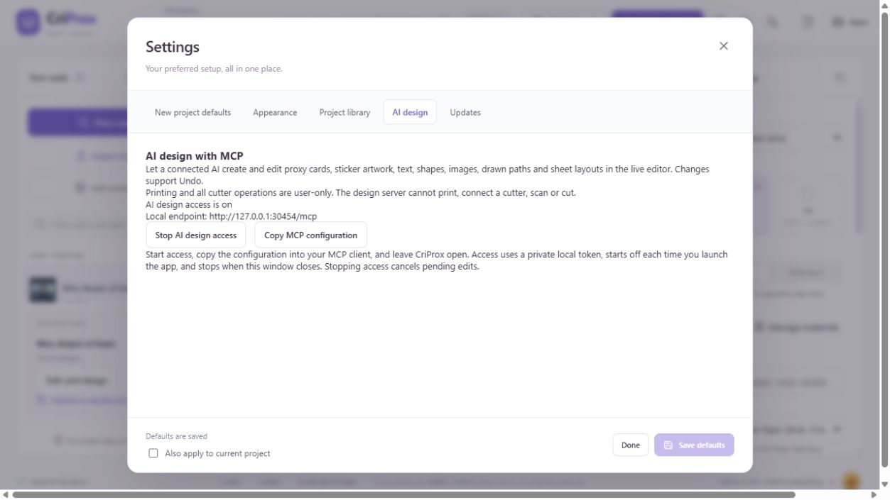
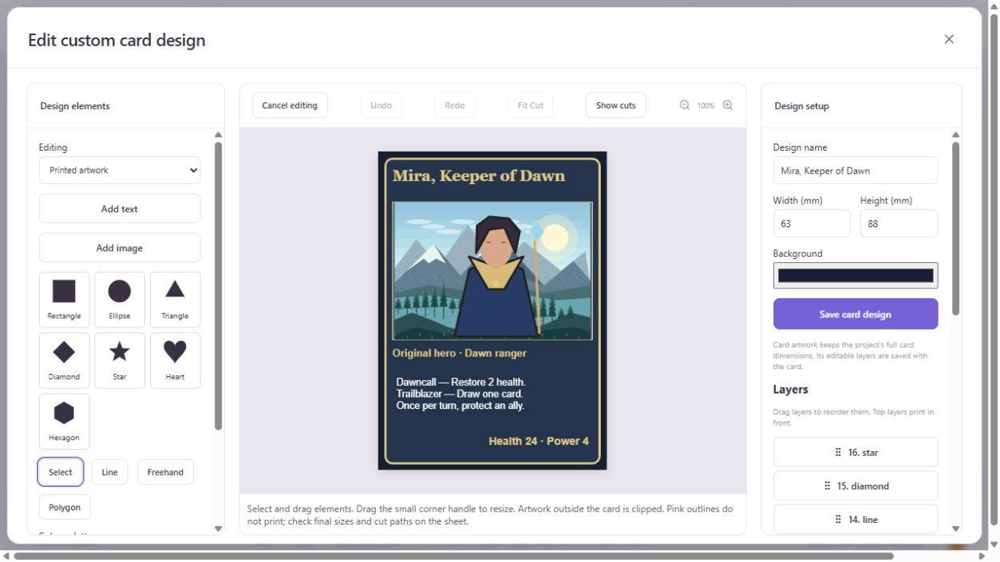

# AI card and sticker design with MCP

CriProx's desktop app includes a local Model Context Protocol (MCP) server for live design work.
An AI client can build proxy cards, original hero cards, illustrations and sticker sheets using
the same editable artwork and layout models as the app. Printing and every cutter operation remain
user-only: the server exposes no printer, PDF preparation, cutter connection, scan, motion or cut tools.

## Connect an AI client

1. Open the updated desktop app and choose **Settings → AI design**. This page is available from Home
   and either workspace. Access starts **off** every time the app launches.
2. Choose **Start AI design access**, then **Copy MCP configuration**.
3. Add that configuration to your MCP-capable AI client and connect. Keep this CriProx window open.
   The copied configuration launches CriProx's dedicated stdio relay with Electron's bundled Node runtime; that mode does not load
   the desktop printer or cutter services. No separate Node.js installation is needed for a packaged app.
4. Ask the AI to read `get_design_capabilities`, inspect your workspace, make a design and show a
   `preview_design` image. Its changes appear in the live editor and support **Undo / Redo**.
5. Use **Stop AI design access** to revoke access and cancel pending edits. Closing the owning window
   also stops the server. If another CriProx copy already owns the connection, stop access there first.

After restarting the app or stopping and restarting AI access, reconnect your MCP client so its relay
reads the new local endpoint and token.

The copied JSON uses the common `mcpServers` configuration format:

```json
{
  "mcpServers": {
    "criprox": {
      "command": "C:/path/to/CriProx.exe",
      "args": ["C:/path/to/resources/ai-stdio.cjs", "--connection-file", "C:/path/from/copied/config/ai-design-connection.json"],
      "env": { "ELECTRON_RUN_AS_NODE": "1" }
    }
  }
}
```

Use the actual values copied by your app. For a client with separate command and argument fields,
enter those fields individually. Clients that use TOML can express the same command as:

```toml
[mcp_servers.criprox]
command = "C:/path/to/CriProx.exe"
args = ["C:/path/to/resources/ai-stdio.cjs", "--connection-file", "C:/path/from/copied/config/ai-design-connection.json"]
env = { ELECTRON_RUN_AS_NODE = "1" }
```

The transport binds only to `127.0.0.1` on an allocated port. A random token in the app's private
connection file authorizes the relay; the UI and configuration contain the path, not the token.
Browser-origin requests, unexpected Host headers and unauthenticated requests are rejected. Requests
are bounded to 64 MB, edits are serialized, and stale edits are rejected if the user changes the
project while the AI is rendering. The server does not read Cricut sessions or keys. An AI client
receives the project data requested through tools; choose a client you trust with your artwork.



## Tools

| Tool | What the AI can do |
| --- | --- |
| `get_design_capabilities` | Read the drawing guide, dimensions, fonts, palette and limits. |
| `get_workspace` | Inspect project settings, design IDs, editable layers and placements. Embedded image bytes are omitted by default. |
| `create_project`, `load_project` | Start or load a native card/sticker project in its edit workspace. The previous design remains undoable. |
| `search_cards`, `add_catalog_cards` | Search CriProx's cached Scryfall catalog and add specific printings to a proxy deck. These two tools may contact Scryfall. |
| `create_design` | Create a sticker illustration or original custom card; optionally start with an editable hero-card frame. |
| `edit_design` | Batch layer creation, updates, deletion, duplication and ordering; edit text, fonts, size, colors, strokes, opacity, rotation, reflection and path points. |
| `manage_design` | Duplicate or remove a design and its placed copies, with Undo support. |
| `import_artwork` | Import embedded PNG/JPEG/WebP or a sanitized plain SVG. No remote URLs or filesystem paths are accepted by this tool. |
| `fit_design_cut` | Fit an editable sticker boundary around artwork, with border width and optional printed stroke. This changes geometry only. |
| `edit_sticker_items` | Add copies and edit their size, position, rotation, reflection, sheet or corner radius; duplicate or delete a copy. |
| `edit_card_entries` | Change quantity or face, duplicate entries and remove cards. |
| `update_project_settings` | Change paper, machine guides, supported layout dimensions, spacing, radius, artwork fit, border and resolution. |
| `arrange_stickers` | Use the existing background nesting worker to arrange stickers or fill a sheet. |
| `preview_design` | Return a PNG of a design or sheet, optionally with preview-only cut lines, at up to 2048 pixels. |
| `export_project` | Return native project JSON that the client can save locally. The app's normal Save action remains available. |
| `workspace_history` | Undo or redo workspace changes. |

Design mutations open the edit workspace, never the print/cut page. AI access pauses while a human
is editing a design or the workspace is busy. The server cannot execute scripts, arbitrary IPC,
shell commands, or commands outside its closed tool catalogue.

## Detailed drawings and original cards

All drawing coordinates and sizes use **millimeters**, with the origin at the top left. Each design
can contain **500 editable layers**. Text supports multiple lines, alignment, font, font size and
bold. Drawn paths contain up to 2,000 normalized points inside their bounding box, with a total
100,000-point limit per design. Closed drawn paths can have solid fills. Layer order is bottom to top.

A detailed landscape can use separate sky bands, clouds, distant ridges, snow caps, water reflections,
tree trunks, foliage and highlights. The AI should inspect previews and refine the composition.
The included original example uses 182 editable layers:


For a new hero card, use `create_design` with `workspace: "cards"` and a `hero` object containing
`title`, `subtitle`, `rules`, `stats`, optional `accent`, and optional embedded `artwork`. The frame,
text and illustration remain editable. Add original portrait layers, inspect the preview, and adjust
text to fit. Select the card in Proxy Card Builder and choose **Edit card design** to edit its saved
layers using the shared design editor. Card canvases keep the project's card dimensions.



The server supplies drawing tools, not an image-generation model. A connected AI can construct vector
illustrations itself or import a raster image made with its own image-generation tools. Embedded
images can be positioned, resized and styled as layers, but their painted pixels are not converted
into editable vector shapes automatically.

The original example layer recipes are in `examples/ai-design-scenes.cjs`. Renderer regression tests
create both projects through the actual MCP HTTP transport and save local example project files and
PNG previews in the ignored `tmp/` folder.

When the design is ready, the **user** opens Print then cut, reviews the sheet, prints it, loads the
mat and starts cutting. An AI-generated boundary is a design, not proof of physical cut alignment.

Implementation uses the [official MCP SDK](https://ts.sdk.modelcontextprotocol.io/v2/) with a
backward-compatible MCP transport for existing stdio clients.

AI design edits preserve the current project in Recents before creating or loading another project. If a human opens an editor while an AI operation is rendering, that AI edit is rejected without closing the editor. Catalog card artwork is embedded before it becomes editable; sticker sheet previews use the same cropping, padding, clipping, and border renderer as printed artwork. Changing the sticker machine clears incompatible captured registration marks.
