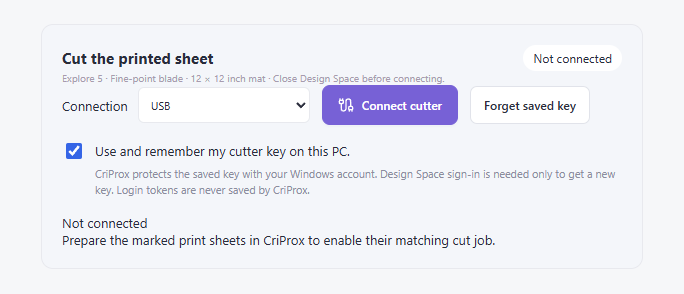
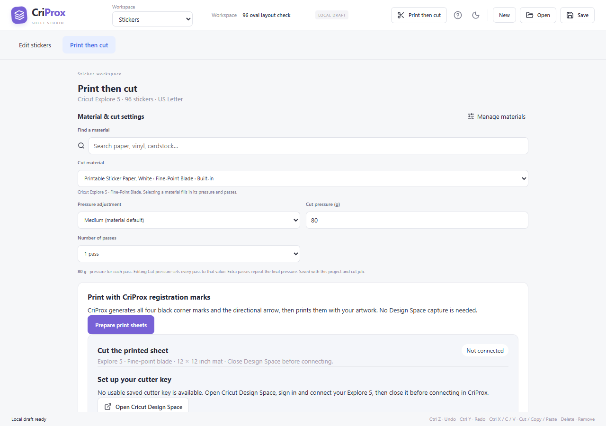
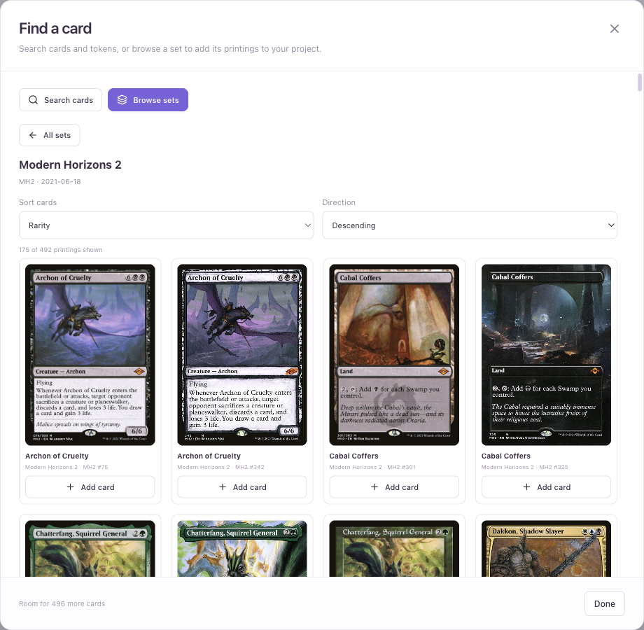
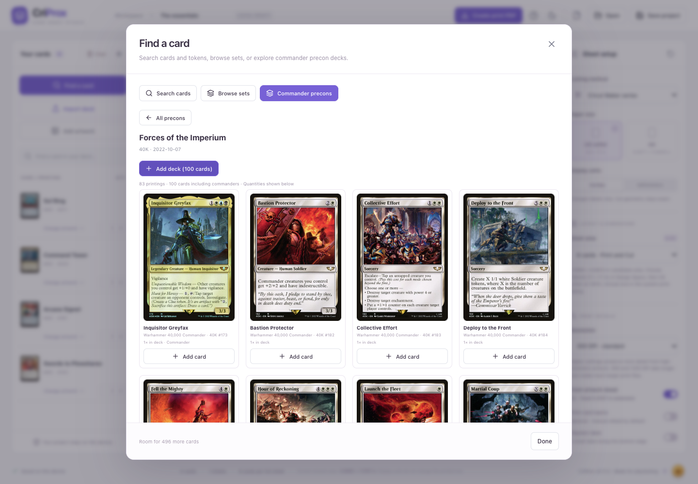
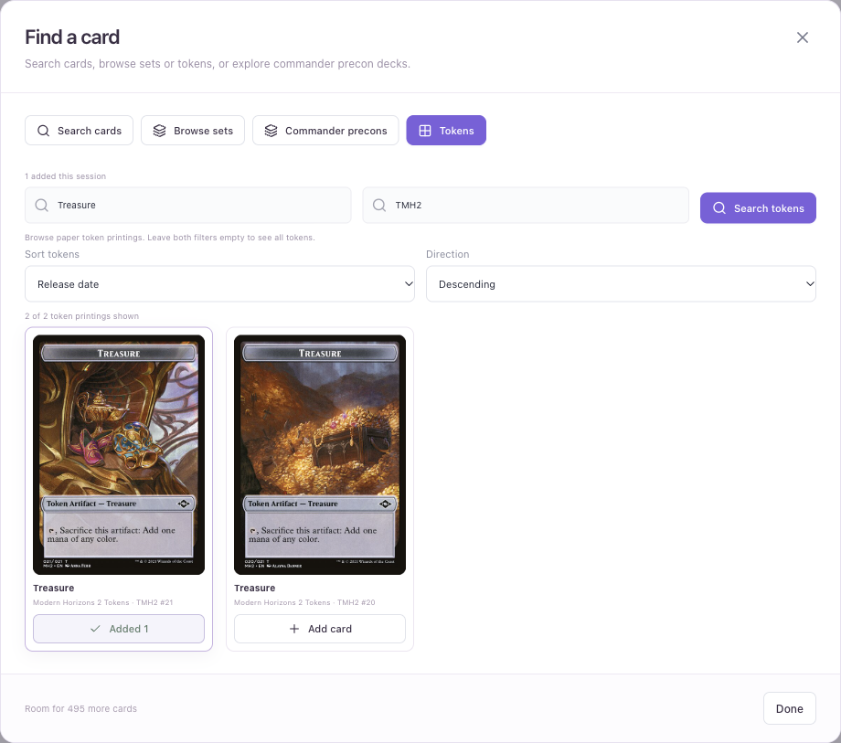
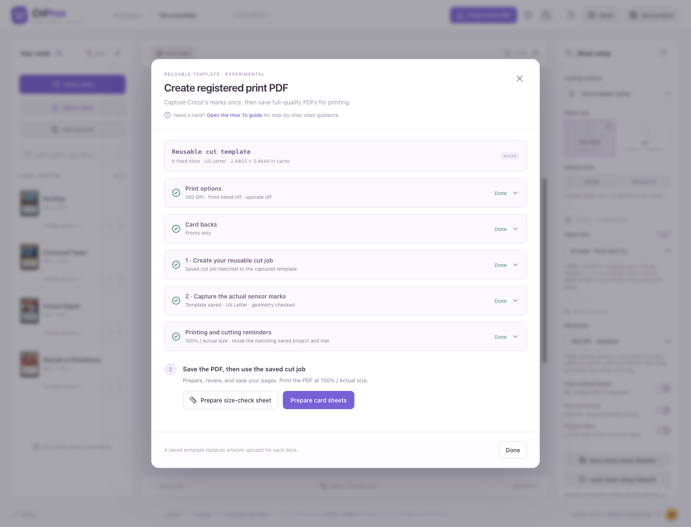

# Cricut workflow and physical validation

**Prepare, print, and cut matching sheets in CriProx.** The Windows Explore 5 workflow now submits native registration scans and sheet contours. A full Explore 5 USB sticker sheet scanned and cut successfully at 80 g, one pass; the user confirmed usable stickers.

Start on **Home** and choose **Proxy Card Builder** or **Stickers**. Continue a draft, start a new project, or open a recent project. Home's **Open project** detects the project type automatically; the CriProx logo returns Home.

Use **Show cuts** above either workspace's sheet to inspect thin dashed pink cut contours over the artwork. Proxy Card Builder follows each placed card's dimensions and corner radius, including rotated cards and partial sheets. This toggle only changes the editor preview; it does not print the guides or change the cut job.

## Generate registration marks in CriProx

AI clients can optionally prepare editable card and sticker designs through **Settings → AI design**.
They can draw detailed layered artwork, create original hero cards, edit cut boundaries and arrange
sheets. AI cannot open the print workflow or operate printers/cutters through MCP. The user reviews
the design and performs the print/cut steps below. See [AI design with MCP](AI-DESIGN-MCP.md).

1. Choose the machine and Letter or A4 paper, then arrange cards or stickers. Choose a material in **Print then cut** or sheet setup to fill its pressure and pass count automatically. Use **Manage materials** to search the imported Design Space catalog, create a preset, or edit pressure and passes. Light/Medium/Hard adjusts the selected material; changing **Cut pressure (g)** sets every pass to that value.
2. Open **Print then cut → Prepare print sheets** in either workspace. Every front page gets four black corner marks and a directional arrow, including partial sheets. Only occupied items become cut contours. Stickers use their editable custom blade paths when provided, otherwise rounded rectangles. Imported artwork edges are not automatically traced.
3. Inspect the PDF preview and warnings. Use **Preview zoom** to inspect small text at up to 300%. Preview resolution follows the window size and display pixel density; zoom does not change physical dimensions.
4. Choose **Print sheets**, **Print fronts / Print backs**, or **Print double-sided**. CriProx opens a **Print preview** with the full page image, navigation, and zoom. Choose printer, copies, color, page range, and one-sided or duplex output, then **Print**. Pages are rendered at 300 DPI with exact paper dimensions and 100% scale. **System printer settings** opens advanced driver options; that Windows dialog may lack its own preview image. Choose matching paper, **Actual size**, no headers, and no fit/shrink. Browser users set duplex in the browser dialog. PDF export remains available at the chosen project resolution.
5. Optionally **Save PDF + matching cut job** to keep the print and coordinate reference together. A saved project can be reopened and prepared again for cutting. The exported JSON is not a Design Space project and is not imported as an executable machine command.

CriProx uses independently implemented geometry measured from Design Space 10.8.81: 25.4 mm arms, approximately 1.5 mm thickness, a fixed 12.7 mm page inset, and 6.35 mm inner clearance. Explore 5, Explore series, Maker series, and Joy Xtra share these measurements. Black marks and the arrow print; amber clearance and blue layout guides do not. Artwork crossing marks or paper edges blocks preparation. Eight full-size cards need A4 or a different layout. Clearance warnings require inspection.

Generated sheets must use their matching CriProx job. An unrelated Design Space mat can position marks differently. The optional captured-template workflow below retains its exact saved Design Space job and cannot be sent through CriProx's generated-sheet cutter.

The desktop material library imports the cached Design Space catalog on first use. If materials are missing, browse them for your machine in Design Space, then choose **Manage materials → Refresh from Design Space**. Your CriProx edits survive refresh. Each saved project and prepared job keeps a copy of its selected material settings; select the material again to pick up newer library edits. See the [material manager reference](FEATURES.md#material-manager-pressure-and-passes).

## Cut the printed sheet on Explore 5

1. On Windows, keep the inspected Design Space 10.8.81 installation. Before the first connection, sign in there and close it. A saved cutter key allows later connections without reopening Design Space while that key remains valid. Connect one powered-on Explore 5 by USB (recommended). Bluetooth LE remains experimental.
2. Open **Print then cut**. CriProx automatically attempts one connection with an available saved key, using the last selected transport. If no usable key exists, choose **Open Cricut Design Space**, sign in and connect the cutter there, then close Design Space. Back in CriProx, check **Use and remember my cutter key on this PC** and choose **Connect cutter** to obtain a new key. After a verified handshake, it saves only the machine key with Windows account protection. Login tokens stay in memory and go only to Cricut's machine-settings endpoint. To remove the saved key, disconnect and choose **Forget saved key**.
3. Select the prepared **Printed sheet**. Its front PDF page and contour count identify the sheet, including duplex jobs. Check the displayed material, pressure, and passes. White sticker paper uses 76/80/84 g and defaults to one pass; the imported medium 80 lb cardstock profile uses 171/180/189 g and defaults to two passes. Imported multi-pressure materials retain their per-pass sequence. Confirm the profile says Explore 5 and Fine-Point Blade before direct cutting.
4. Secure that printed front face up in portrait orientation at the upper-left of a 12 × 12 inch mat's adhesive grid. Its upper-left arrow points toward the machine. Leave all four marks visible. This placement is for CriProx's generated coordinate frame; the separate Design Space A4 instructions below differ.
5. Confirm that this exact front page was printed at actual size and that the fine-point blade and mat are ready. Choose **Cut sheet**, then press the machine's Load button when prompted. CriProx resumes measurement and the scan/cut sequence automatically; a second Go press is not required by this controller.
6. Watch the app's status. A failed scan cancels instead of bypassing registration. **Pause / Resume** and **Cancel cut** control the active job. A 30-minute deadline also requests cancellation. Wait for completion and idle status before unloading. The job keeps its original geometry and settings even if you edit the project.

**Hardware validation:** USB authentication, firmware 4.8.2 status, homing, and a one-pass 80 g square have succeeded. The square-test UI has been removed. A full printed sticker sheet subsequently scanned and cut successfully at 80 g, one pass, producing usable stickers. Other paper/material settings, pause/resume, and repeatability still need hardware checks. Start with one pass on inexpensive printed material and measure alignment before production. Other cutter models cannot connect through this controller.

## Choose a workspace and check its guides

Select **Cards** or **Stickers** from the main-window **Workspace** dropdown. In both editors, add artwork and edit the selected item on the left, preview the sheet in the center, and choose machine, paper, and layout on the right. Open and Save are in the shared top bar. Choose the machine and paper before arranging the sheet. Blue is the layout area, amber reserves sensor clearance, and black marks match the generated PDF. A matching captured template instead displays its original marks. The dashed published maximum extents do not describe a completely usable rectangle. See [machine-guide details](FEATURES.md#workspaces-shortcuts-and-machine-guides).

**Ctrl+Z / Ctrl+Y** undo and redo. **Ctrl+X / Ctrl+C / Ctrl+V** cut, copy, and paste selected items within
the active workspace; text fields retain their usual shortcuts. Command works on macOS. Switching workspaces
keeps their drafts and histories; portable card and sticker files remain separate.
**Delete** removes the selected item and **Ctrl+Z** restores it. In the sticker library, clicking a design and pressing **Delete** removes the design and all its sheet copies; clicking a sticker on the sheet deletes only that copy. Designs with zero copies can also be deleted this way. Registration marks are included in every generated front PDF page. Artwork-only exports are explicitly for the optional Design Space import workflow.

## Shared Print Then Cut workspace

Choose **Print then cut** from either workspace to generate the marked PDF and matching cut coordinates, print at actual size, and check cutter connection. Manual nine-card layouts use their manual cut guide without optical registration.

**Connect your cutter** supports Explore 5 in the Windows desktop app. Opening the cut page attempts
one connection with the saved key; Home and editing pages do not connect. If a key is missing or
rejected, the setup prompt offers **Open Cricut Design Space**. Sign in with Design Space 10.8.81,
connect the cutter there, then close it and authorize remembering the key in CriProx.
Connect shows encrypted status, firmware, and carriage state.
Bluetooth LE is experimental; use USB if the cutter is not found. Internet access and a current
Design Space session are needed to obtain a new machine key, but a saved key is tried without them.
If its handshake fails, CriProx removes it and shows setup. Automatic connection never reads the
account session or fetches a replacement key. **Disconnect** stays disconnected for this page visit;
choose **Connect cutter** or return to the cut page to try again. Connection does not start cutting.
An expired login requires signing in through Design Space again. Key lifetime after power cycles and over
time remains unverified. If saving fails, the status says so and the current connection can still work.
The key is encrypted for your Windows account in CriProx's app data, separate from projects. Login
tokens are never persisted by CriProx, and neither tokens nor keys reach the renderer.

The generated-sheet workflow above provides the actual **Cut sheet** controls. Disconnect before using Design Space; closing CriProx cancels an active job and releases its connection. The captured-template route continues through its saved Design Space job.

## Design a sticker with text, shapes, images, and lines

1. In **Stickers**, choose **Create sticker** on the left. Set its name, width, height, and background on the right.
2. Add text, a shape, or a PNG/JPEG/WebP image. Choose a palette or custom colors. **Line** and **Freehand** draw directly on the canvas; select a stroke to change its width and color.
3. Drag elements to position them, drag the small corner handle to resize, or use the selected-element controls for exact dimensions, rotation, mirroring, fill, outline, and opacity. Drag rows in Layers to change the order, or use Bring forward/Send backward. Ctrl+Z/Ctrl+Y undo and redo.
4. Choose **Save design to sheet**. With a closed cut outline, the sheet dimensions crop automatically to the cut bounds; the original canvas stays editable. Then choose **Fill last sheet** to repeat it with shape-aware spacing and staggered circles, or **Auto arrange** to repack existing copies. Select a design and choose **Edit design** to revise its layers later. Save the project to retain the editable design locally.
5. To edit the blade path, choose **Editing → Cut paths**. Add a shape, draw an open **Line**, draw a closed **Freehand** outline, or click **Polygon** corners and choose **Finish outline**. Select a path to change its position, size, rotation, and vertices. **Element use** converts a printed shape to a cut; **Add default outline** starts with an editable rounded rectangle. Custom paths replace the default outer cut.
6. Toggle **Show cuts** on the sheet to inspect the pink blade paths after sizing, mirroring, or rotating copies. These overlays do not print. **Use default sheet cut** restores the normal rounded boundary. Continue with **Print then cut** above. Custom blade paths require this generated-mark workflow; a captured template or Design Space image import has different cut geometry.

For an automatic outer outline, set **Border width (mm)**, **Border stroke (mm)**, and its color in the designer's **Fit Cut border** section, then choose **Fit Cut** above the canvas. It encloses all visible elements as one sticker, including gaps between them, and expands the canvas to preserve artwork near its edges. A zero stroke disables the printed border. Inspect the thin dashed pink cut guide before **Save design to sheet**. These display guides are separate from any border stroke you choose to print.

Auto arrange and Fill show background progress and **Cancel layout**. Cancel keeps the existing sheet; complex shapes can use the safe grid fallback after the nesting search budget is reached.

Custom shapes, open paths, transforms, and registration limits passed automated checks and native offline plot construction. Their physical alignment has not yet been tested; the earlier successful hardware run used rounded rectangles.

## Sticker sheets and label batches

For local printing, arrange your stickers and use **Prepare print sheets** as described above. The steps for export/capture below are optional alternatives for cutting through Design Space.

To preserve a label's text and logos, choose **Keep entire image** or **Trim empty space — keep artwork** in Sheet setup. The trim option removes blank outer margins without enlarging content past the cut, including when opening an older project saved with Crop to fill. Set **Border width (mm)** for white padding around imported artwork, **Border stroke (mm)** for an optional printed outline, and its color. A zero stroke turns the outline off. These controls apply to imported stickers; custom designs retain the artwork and paths edited in the designer.

Right-click a design in the left library for editing and placement actions. **Delete all copies** clears its placements while keeping the design. **Delete design** removes that library entry and its copies; **Delete all designs** clears the entire sticker library and sheets. Ctrl+Z restores these actions. Library Copy/Paste makes independent designs without placing copies; select a sticker on the sheet to copy or delete only that instance.

1. Choose **Workspace → Stickers**, then select the machine, paper, label dimensions, spacing, and layout limits.
2. Choose **Add artwork** and select all your individual image/SVG files at once. They are placed in
   natural filename order. For an existing SVG with one top-level group per label, use
   **Import labels from grouped SVG** instead. Selecting the complete sheet PNG imports it as one
   image; it does not extract individual labels. Individual imports preserve aspect ratio and SVG physical
   dimensions.
3. For repeated labels, select the design and choose **Fill last sheet**. Choose **All designs** to
   repeat the collection. Review the sheet preview, dimensions, and number of sheets. A full sheet
   is not duplicated by Fill; choose **Add one** to start the next sheet. Use **Auto arrange** to repack varied sizes or repair older placements that cross the guides. Import, Fill, and Auto arrange respect the machine’s planning bounds and reserved registration corners. Fill preserves existing placements and uses the better of shape nesting and a grid. Created stickers with closed cut outlines can share rectangular bounds without overlapping their silhouettes; spacing stays between their cut shapes. Older designs keep their saved frame until edited and saved again. Select a sticker to drag, resize, rotate, mirror, or flip it.
   Exact dimensions and positions are in the inspector; Undo/Redo restores edits.
4. Choose **Save file** to keep the artwork, arrangement, and capture together locally. Reopen with
   **Stickers → Open file**. The card project library and sticker files are separate.
5. Open **Print then cut**. For freely arranged stickers choose **Export sheets for Design Space**, unzip the files, and upload
   each PNG as a Flat Graphic / Print Then Cut image. Set the occupied-artwork dimensions listed in
   `READ-ME.txt` and check that each label has exactly one outer cut. The SVG is a reference; enabling
   it alongside the PNG contours would create duplicate cuts. Select the same machine and paper in both apps.
   If Design Space rejects the arrangement, reduce the layout limits or count instead of rescaling
   the finished labels. Print and cut within the same Design Space job.
6. For fixed-slot layouts only, the **Export and reusable registration templates** section offers
   **Save setup PNG** for experimental reusable PDFs. Individual movement, resizing, rotation, mirroring,
   or flipping switches to free layout and clears any old capture. Import that magenta template as one
   flat Print Then Cut image with the exact full-template dimensions displayed by CriProx. Save the
   project and its mat arrangement in Design Space. Disable bleed and save the complete print page
   as a one-page color PDF. Use **Capture Design Space PDF** to measure it. CriProx preserves the
   original marks and directional arrow, including marks in empty tapered corners; this optional route retains Design Space’s original geometry. A capture passing measurement is not proof that a sensor can read it.
7. Choose **Save print PDF** and print at 100% / Actual size. Test one plain-paper sheet before using
   sticker stock. Keep the exact matching saved Design Space cut job. A partial registered sheet
   leaves blank artwork in unused slots, but that full-template job still cuts those slots. Changes
   to paper, dimensions, spacing, corners, layout, or layout limits require a new capture.
8. Complete material/pressure selection and cutting in Design Space. On Explore 5, place A4 **landscape on the mat**,
   with the printed directional arrow in the upper-left corner pointing up. Press the machine's Go
   button when prompted and unload after completion. The workflow's **Open matching job in Design Space**
   disconnects CriProx and launches the installed app; choose the matching saved job yourself.

Explore 5 cutting and captured-PDF reuse remain unvalidated on physical hardware. Cricut recommends
printing and cutting in the same Design Space session and warns that PDF printing outside that flow
can affect sensor-mark sizing. Its [Explore 5 guide](https://help.cricut.com/hc/en-us/articles/38613592650903-How-to-Print-Then-Cut-with-Cricut-Explore-5)
also specifies the A4 mat orientation and directional arrow.

For cutter-integration development, the source checkout provides an offline engine probe and
optional native USB/Bluetooth discovery. Follow [the integration investigation](EXPLORE-5-INTEGRATION.md#run-the-repeatable-investigation).
Discovery does not replace any of the print/cut steps above.

The remaining card workflow below is unchanged.

To add cards by name, open **Find a card** and start typing. The search box receives keyboard
focus automatically when the dialog opens.
Selecting text or dragging from inside the dialog and releasing outside keeps it open.
Click outside the dialog or choose **Done** to close it.

Click a card on the sheet to open its artwork preview. Placed cards stay on the sheet when you
click and drag, so they cannot be accidentally added again. To add local artwork, drop image files
from your file manager onto the sheet or use **Add artwork**.

To repeat artwork, right-click a card on the active sheet and choose **Duplicate** to insert one
copy after it, or **Fill Page** to fill that sheet's empty slots with the same artwork and selected
face. Existing cards stay on the sheet; duplicating on a full sheet moves overflow to the next
sheet. Fill Page is unavailable when the sheet is full or filling it would exceed 500 cards.
Duplicate is unavailable at the 500-card limit. **Change Artwork** opens the clicked copy's
artwork picker. You can also focus a card and press **Shift+F10** or the context-menu key, then
use the arrow keys and Enter. Press **Escape** or click outside to close the menu.

To remove one card, right-click it and choose **Delete Card**. The **Delete this card?** popup
names the card and removes only the clicked copy after you choose **Delete card**. Choose
**Cancel**, press **Escape**, or click outside the popup to keep it. Other copies remain in your
project, and later cards move forward to fill the space.

While reviewing the sheet, scroll the mouse wheel to zoom in or out. To move around the preview,
left-click and drag empty space on or around the paper, or hold the right mouse button and drag
anywhere, including over a selected card. Release the button to stop panning. This changes only
your view; card positions and print output stay the same.

## Build a sheet from a set

1. Open **Find a card** and choose **Browse sets**. Filter by a set name or code, such as `MH2`.
   Paper sets include separate token and supplemental collections; digital-only sets are omitted.
2. Click a set to browse its printings. **Sort cards** offers collector number, name, color, rarity,
   mana value, and artist. Choose ascending or descending order; sorting covers the whole set.
3. Use **Load more cards** to continue browsing, and **Add card** under the artwork you want.
   Repeated additions increase that printing's quantity. Other printings of the same card keep their
   own artwork. Use **All sets** to select another set or **Search cards** to return to name search.
4. Choose **Done**, review the sheet and its quantities, then set paper, layout, bleed, and card backs
   before preparing the print PDF. The project limit remains 500 cards.

Set browsing needs an internet connection on first use. Successful catalog and card responses are
cached for one day. Viewed previews are cached separately by image URL and reused when you change
sort order, reopen Find Card, or restart the app. Newly encountered images still need a download;
older previews are evicted when the preview cache reaches 1,024 images or 128 MiB. Announced sets
can appear before searchable card artwork is available.

## Build a sheet from a commander precon

1. Open **Find a card → Commander precons**. Filter by a deck name or set code, such as `40K`,
   and choose **Newest first** or **Name A–Z** to sort the catalog.
2. Open a deck to see its included printings. Each card shows its deck quantity, and commanders
   are labeled. **Add card** adds one copy of that printing; repeat additions increase its quantity.
3. Use **Add deck** to add the commanders and mainboard together, preserving all quantities,
   including basic lands. Tokens, display commanders, sideboards, planes, and schemes are excluded.
   The whole deck must fit within the 500-card project limit and have artwork for every printing.
   If artwork is missing, retry or add the available cards individually.
4. Use **All precons** to choose another deck, or **Done** to review the sheet and prepare the
   print PDF with your chosen paper, layout, bleed, and card backs.

Precon decklists come from MTGJSON and their exact printing artwork comes from Scryfall. First use
needs an internet connection; catalog, decklists, and complete printing lookups are cached for one
day. Availability follows the source catalog rather than a fixed bundled list.

## Add tokens to a sheet

1. Open **Find a card → Tokens** to browse paper token printings, starting with the newest.
2. Enter a token name such as `Treasure` or `Goblin`, optionally enter a token set code such as
   `TMH2`, and choose **Search tokens**. Leave both filters empty to browse all tokens.
   Token set codes can differ from the main set code; **Browse sets** lists their names and codes.
3. Choose **Sort tokens** and **Direction** to sort by release date, name, set/collector number,
   color, or artist. **Load more tokens** continues through the matching printings in that order.
4. Choose **Add card** under the artwork you want. Repeated additions increase that printing's
   quantity; double-faced tokens retain their matching reverse artwork. Choose **Done** to review
   your sheet and prepare the print PDF. Tokens share the 500-card project limit with other cards.

Token browsing needs an internet connection on first use. Successful searches are cached for one
day, and previews use the same image cache as card and set searches.

## Choose alternate artwork

1. Click a card on the sheet and choose **MPC Autofill** in its artwork picker.
2. **Sort artwork**, to the right of the search box, starts with **DPI: highest first**.
   Choose lowest DPI, name A–Z or Z–A, or **Recently updated** to change the order.
   The same options appear when browsing token
   artwork or MPC Autofill card backs.
3. DPI sorting compares the results loaded so far. Choose **Load more** to add more choices;
   the combined list is sorted again. Name and update sorting cover the full search.
4. Select an image to apply it to the current copy, then review the sheet before printing.

Source DPI describes available image detail; the output DPI in Sheet setup controls export density.

## Understand the integration boundary

CriProx generates registration marks and matching page coordinates locally. Its Windows Explore 5 controller can scan and cut those generated sheets using their matching coordinates. It does not create native Design Space project files. The separate captured-template workflow preserves the original marks from the exact saved Design Space job and runs through Design Space.

The standard export PNG contains one opaque rounded silhouette per card and transparent gaps. Its companion SVG contains matched vector geometry, not registration data. Inspect the traced contour in Design Space before printing, and do not enable both the PNG's cut contours and the SVG paths unless you deliberately intend duplicate cuts.

The layout engine works in millimeters. PNG density metadata is included, but always set **both** Canvas dimensions to the values in the supplied manifest. Do not use Auto-Resize or printer fit-to-page. Design Space tracing, paper feed, printer scaling, cutter calibration, material, and mat condition can all add error after CriProx creates the files.

The dashed rectangle in the preview is a planning guide. It is not a registration mark or a certified, model-specific outline of Cricut's usable area. Machine selection records the intended target and tailors instructions; it does not emulate firmware or guarantee that a particular job will pass Design Space's checks.

## Optional workflow: reuse a saved Design Space cut project

### One-time template setup

1. Choose your machine, output paper, and layout in CriProx, then open **Create print PDF → Reuse a captured Design Space job (optional)** and download the magenta setup PNG.
2. Upload that PNG to Design Space as one flat **Print Then Cut** image, preserve transparency, and set both Canvas dimensions to the values shown with the template. Inspect the contours, then save the project and keep its mat arrangement unchanged.
3. Use Design Space's **Make → Send to Printer** flow to save the job's print output as a complete one-page portrait PDF at **100% / Actual size**, with bleed off. This captures the template; it does not print the deck. Follow the layout-specific paper settings below: six-card and seven-card captures use the selected output paper, while eight-card requires a complete Tabloid capture.
4. Import the captured PDF into CriProx. CriProx verifies the template and saves it for reuse with the matching cut geometry.

The two setup sections collapse automatically with green checks after a verified capture is
imported or loaded. Click either header to see the instructions again, download another setup
PNG, or replace the captured PDF. The check confirms template setup, not physical cut accuracy.

Choose **Done** in **Print options**, **Card backs**, or **Printing and cutting reminders** when
you have reviewed that section. It collapses into a short summary with a green check, and its
header always lets you reopen it. CriProx remembers completion locally for the exact machine,
paper, and cut geometry, including when reopening the app. Relevant settings or card-back
artwork changes reopen the affected section for review; an enabled back section cannot be marked
done while required shared artwork is missing. In the manual Cricut workflow, mark **Physical
cut calibration** done yourself after checking a real test; preparing a target does not complete it.

### For each deck

1. In **Create print PDF**, reopen any completed section you want to change, then prepare and
   inspect the card sheets and save the finished PDF from CriProx. The prepare controls stay visible
   when setup and settings are collapsed. Reminders sit above the prepare controls, so preparation
   leads directly into the preview and save actions.
2. Open the saved PDF in a dedicated PDF application and print on the selected output paper at **100% / Actual size**. Disable fit, shrink, headers, and added margins. CriProx saves PDFs rather than printing directly, preserving the selected artwork resolution and captured PDF content.
3. If backs are enabled, print their artwork onto the same sheets using the chosen refeed or duplex order. Back pages have no registration marks or cut lines.
4. Reopen the exact saved Design Space project and mat. Choose **Already Printed / Skip printing** when available, load the sheet front-side up as instructed, and run the cut.

Run a measured plain-paper test before using card stock. Reuse the template for later decks while
the cut geometry remains unchanged. Changes to paper, spacing, machine, layout, or the saved cut
job require a matching new capture; recapture after changes to Design Space or printer setup.
This reusable PDF process is outside Cricut's recommended print flow and still requires physical
validation on your equipment.

### Alternative: direct PNG printing through Design Space

The separate **Export** package contains artwork PNGs, SVG geometry, dimensions, and a handoff
guide. Its PNGs contain no registration marks. For six-card and seven-card direct PNG exports, upload the artwork PNG
as a flat Print Then Cut image, set both dimensions from the manifest, inspect the contours, and
let Design Space generate the marks and handle printing and cutting in the same session and
device. Eight-card exports direct you to **Create print PDF** instead. Use **Create print PDF**
for the reusable workflow described above.

## Experimental manual nine-card workflow

The nine-card profile is a separate Basic Cut workflow. It bypasses Print Then Cut and its optical
sensor marks. The print PDF and transparent cut PNG share one fixed 191 × 266 mm 3×3 geometry with
63 × 88 mm cards, 1 mm gutters, and 2.5 mm corners.

1. Select **9 cards · Manual Alignment · Experimental** and open **Create manual cut**.
2. Prepare the files. Save the print PDF and `basic-cut.png`; use the same PNG for every print page.
3. Open the PDF in a dedicated PDF application and print on the selected Letter or A4 paper in
   portrait orientation at **100% / Actual size**. Disable fit, shrink, headers, and added margins.
4. Upload the PNG to Design Space as **Basic Cut**, not Print Then Cut. Set both dimensions to
   **191 × 266 mm** (7.5197 × 10.4724 in), keep all nine shapes together, and save the project.
5. Choose **On Mat**. In the Prepare preview, keep the group upright with its top-left at the first
   0.25 in grid inset. Do not center, mirror, rearrange, or auto-resize it.
6. Place the printed page flush with the upper-left corner of the mat's adhesive grid and apply it
   smoothly. Keep the page orientation identical to the Design Space preview.
7. Choose **Prepare 1 mm calibration sheet** and print it on plain paper. Place it exactly as a card
   sheet and cut it with the existing saved nine-card Basic Cut project. The other eight paths cut
   blank paper; this is intentional, because the test must preserve the real project's placement.
8. At the top-left target, count the 1 mm magenta squares between the blade line and the dark left and
   top edges. Enter those measurements and directions in CriProx, then choose **Apply measured
   correction**. Prepare a new calibration PDF after changing the correction; the saved Basic Cut PNG
   and Design Space project do not change. The right and bottom edges should show the same translation;
   disagreement indicates scale or rotation rather than a simple X/Y offset.
9. Repeat the same mat load at least twice after each correction and measure several cards. A changing
   offset indicates paper placement, mat loading, or machine repeatability rather than a value that
   should be compensated in software. Use card stock only after the offset is repeatable.

On iOS, SnapMat can photograph the material on the mat and help visually place the cut group, but it
does not certify scale or replace the repeated physical test. The 191 × 266 mm design is smaller than
Cricut's published 11.5 × 11.5 in maximum cutting area for a 12 × 12 in mat; that size statement does
not guarantee alignment or machine-specific acceptance.

## Physical validation before a full deck

This is the remaining hardware acceptance test. It cannot be completed by a browser test or by comparing generated files.

1. Record the Cricut model, Design Space version, OS, printer/driver, paper size, material, and mat. Choose the corresponding machine in Design Space and CriProx.
2. Calibrate Print Then Cut using Cricut's built-in calibration flow.
3. In CriProx, leave the layout on **6 cards · Print and Cut** and select your desired card size. Open **Create print PDF** and download the reusable magenta setup PNG.
4. Upload the setup PNG as a flat/single-layer Print Then Cut image. Preserve transparency. Inspect its contours: exactly six rounded rectangles, with no interior holes. Set both Canvas dimensions to the values shown with the template. Confirm that Design Space accepts those dimensions without resizing, then save the project and mat arrangement.
5. For US Letter or A4 output, choose **Tabloid (11 × 17 in)** in Design Space. Use **Make → Send to Printer**, turn bleed off, and change the system print dialog to your selected output paper (**US Letter** or **A4**), portrait, at **100% / Actual size**. Save a PDF only if all six slots and all four sensor marks remain on one page, then import it into CriProx.
6. Choose **Prepare size-check sheet** and save its PDF. This is a physical measurement target, not a sensor calibration page. Print it from a dedicated PDF application at **100% / Actual size**, with fit-to-page/shrink-to-fit disabled. Reopen the exact saved Design Space project and mat, choose **Already Printed / Skip printing** when available, and cut the sheet following the model-specific mat-loading instructions.
7. Measure width and height of the cut card and its internal 5 mm grid. A consistent scale error suggests printer scaling or incorrect Canvas dimensions. Correctly sized grid with displaced edges suggests calibration/alignment. Record the error; do not change the physical card dimensions to conceal a sensor alignment issue.
8. Repeat using a full six-card PDF printed from the PDF application and cut with the same saved project. Measure every card, including diagonal position differences. Use three sheets to check repeatability. Decide your own acceptable tolerance before committing a full deck (for example, target at most 0.25 mm edge displacement if your equipment supports it). The 180 × 220 mm planning envelope is a candidate, not a validated Cricut area. Do not use Auto-Resize if rejected; use a smaller batch instead. Recheck the rotated card dimensions.

## Experimental seven-card test

The seven-card profile is a separate 2–3–2 test for Maker and Explore. It fixes the cards at 63 × 88 mm, the corners at 2.5 mm, the spacing at 0.1 mm, and the complete template at 189.2 × 214.2 mm. Do not modify those values.

1. Download the reusable setup template from **Create print PDF** and upload the magenta PNG as one flat Print Then Cut image.
2. Set both Canvas dimensions to 189.2 × 214.2 mm and confirm seven rounded contours. Save the project and keep its mat arrangement unchanged.
3. Choose **Tabloid (11 × 17 in)** as the Print Then Cut page size in Design Space. A4 is too narrow for the middle row.
4. Choose Make → Send to Printer, disable bleed, and open the system print dialog. Change the printer paper to **US Letter**, portrait, at **100% / Actual size**.
5. Save the setup as a PDF only if the preview remains one page with all seven magenta slots and all four sensor marks. Cancel if it clips a mark or creates a second page.
6. Import the resulting one-page Letter PDF into CriProx. Prepare and save a size-check PDF, then print it from a dedicated PDF application on Letter at **100% / Actual size**, with fit-to-page/shrink-to-fit disabled, before using a full artwork sheet.
7. Reopen the same saved Design Space project and mat, choose **Already Printed / Skip printing** when available, and cut the printed sheet. Design Space may require a 12 × 24 in mat because the declared page is Tabloid, even though the printed sheet is Letter.
8. Record sensor acquisition, every cut dimension, edge displacement, and repeatability. The successful one-page PDF capture confirms only the software geometry—not that a physical machine will read or cut it accurately.

## Experimental eight-card Tabloid capture

The eight-card profile fixes two horizontal cards per row across four rows at 63 × 88 mm per card, 1 mm gaps, and 2.5 mm corners. The complete magenta template is 177 × 255 mm.

1. Select the eight-card profile in CriProx, download its magenta setup PNG, and upload it to Design Space as one flat Print Then Cut image. Set both Canvas dimensions to 177 × 255 mm, save the project, and keep its mat arrangement unchanged.
2. Select portrait **Tabloid (11 × 17 in)** in Design Space and the system print dialog. Turn bleed off and save one complete Tabloid PDF at **100% / Actual size**. Keep every card and all four sensor marks on one page.
3. Import that PDF into **Create print PDF**. CriProx verifies the eight-card pattern and checks that all printed content fits on your selected portrait output paper (**US Letter** or **A4**) with at least 1 mm clearance. It moves the complete captured page content and card artwork together, without changing their size. A4 is narrower than Letter; captures that cannot fit are rejected.
4. Save the resulting size-check PDF and print it from a dedicated PDF application on the selected **US Letter** or **A4** paper at **100% / Actual size**, with fit-to-page/shrink-to-fit disabled. Check all four marks on plain paper.
5. Reopen the same saved Design Space project and mat, choose **Already Printed / Skip printing** when available, and cut the printed sheet. Confirm the machine reads the marks and cuts a 63 × 88 mm card before printing a full deck.

The Sheet area selector follows the selected paper and cutting method. Maker and Explore offer six-, eight-, and nine-card layouts for A4; seven-card remains Letter-only. Changing an eight-card project between Letter and A4 preserves its layout but requires a matching capture for the new output paper.

The earlier 0.1 mm-gap sample capture had a 7.63 × 10.63 in marked footprint and about 0.19 in top and bottom clearance after centering on Letter. The revised spacing needs a fresh Tabloid capture and a fit check for the selected output paper. Printer imageable area and borderless expansion can still clip marks. Reuse the same saved Design Space cut job and mat; a successful PDF fit alone does not prove sensor acquisition.

## Exact SVG template

Save repeatable preferences in **Settings → New project defaults**. Use **Sheet** for machine,
output paper, layout, and units; **Print** for DPI, front bleed, labels, and upscaling;
**Card backs** for shared artwork, back bleed, refeed or duplex, flip, and orientation; **Cut guides**
for manual guides; and **Alignment** for measured printer and cut corrections. Card dimensions, corner radius,
and spacing are fixed by the selected layout and cannot be edited in Settings. Changing machine or paper keeps layout choices
compatible.

Edits stay in one draft as you switch groups. **Save defaults** saves everything for future projects.
Select **Also apply to current project** to use the setup on the open deck as well; its name and
card list are preserved. **Use current project** copies that deck's setup into the draft, and
**Reset to factory** prepares factory choices. Review either before saving. **Undo changes** returns
to the saved defaults; closing with unsaved changes offers a choice to keep editing or discard.

In **Card backs**, review the artwork preview and source-bleed toggle. You can replace or remove
artwork; disabling backs keeps it saved for later. Upscaling choices stay with each project when
you close and reopen **Create print PDF**. If saved Upscayl is unavailable, choose Built-in ESRGAN
or turn upscaling off before preparing card sheets.

Front and back bleed controls are independent on/off toggles. Front bleed and the bleed between card backs are fixed at 0.5 mm for the six-card and eight-card profiles and 0.05 mm for the tightly spaced seven-card profile. Because back pages do not contain registration marks, enabled back bleed extends 1.5 mm past exposed outside edges to cover small front-to-back alignment shifts without changing card positions or cut geometry.

When a selected Scryfall card has two faces, CriProx warns that card-back printing is required. With
card backs enabled, the face opposite the selected front is placed in that card's mirrored back-side
slot automatically. The shared card-back artwork applies only to single-sided cards; it remains required
for a mixed deck that contains any single-sided cards.

Each PNG is accompanied by an SVG with the same dimensions, origin, card positions, rotation and rounded corners. It contains only opaque vector shapes, with no page background, strokes, registration marks, embedded images or clipping paths.

The PNG's alpha silhouette is the recommended Print Then Cut input. The SVG is supplied for inspecting the intended geometry or a separate Basic Cut workflow. It does not tell Cricut where an independently printed page lies. Do not add the SVG as another enabled cut layer over the PNG unless you are deliberately testing a different, validated workflow: that can cause duplicate cuts.

## Physical acceptance record

| Field                             | Value                        |
| --------------------------------- | ---------------------------- |
| Machine / firmware                | Pending                      |
| Design Space / OS                 | Pending                      |
| Printer / driver                  | Pending                      |
| Paper / material / mat            | Pending                      |
| Export settings / manifest        | Pending                      |
| Import dimensions confirmed       | Pending                      |
| Outer contour count confirmed     | Pending                      |
| Card dimensions after cutting     | Pending                      |
| Maximum edge displacement         | Pending                      |
| Repeatability across three sheets | Pending                      |
| Six-card result                   | Pending                      |
| Seven-card one-page PDF capture   | Passed; physical cut pending |
| Seven-card sensor / cut result    | Pending                      |
| Nine-card Basic Cut import        | Pending                      |
| Nine-card manual alignment result | Pending                      |

Until this record is filled in with real measurements, the application is a software-tested prototype, not a guarantee of perfect Cricut alignment.

For experimental connection diagnostics from a source checkout, see the
[Explore 5 connection probe](EXPLORE-5-INTEGRATION.md#physical-connection-probe). A successful BLE
firmware read and an authorized encrypted USB homing test have succeeded. The user confirmed
movement with the blade removed. The app also scanned and cut one complete USB sticker sheet at 80 g, one pass. Other settings and repeatability still need physical validation.
