# CriProx feature reference

## Home and recent projects

CriProx opens on **Home**, with **Proxy Card Builder** for gaming cards and **Stickers** for labels and custom designs. Choose a workspace to continue its draft, or **New project** to start fresh. **Open project** recognizes either project-file format and selects the matching workspace. Click the CriProx logo or choose **Home** in the workspace menu to return.

Home shows both current drafts, recent local copies, and saved desktop card projects. Starting fresh from Home preserves the previous draft as a recent copy. Recent copies persist on this device across restarts; up to eight snapshots are retained within a 90 MB cache budget, always retaining the newest snapshot. Original project files and the desktop project library remain the long-term saved copies. The home layout and workspace menu share one mode registry so additional builders can be added consistently.

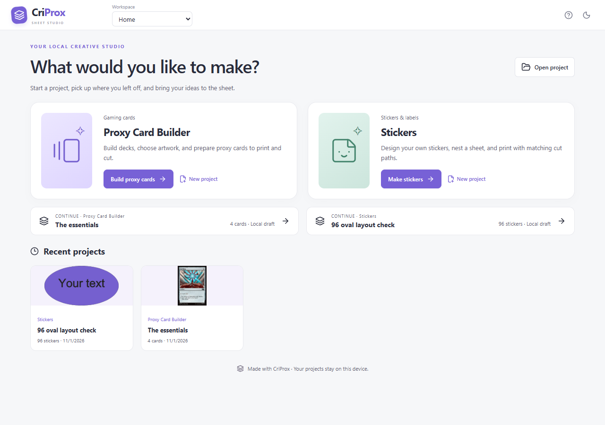

## AI design tools with MCP

Desktop **Settings → AI design** enables a local MCP server that can create and edit proxy cards,
original hero cards, sticker illustrations and sheet layouts in the live editor. Copy its client
configuration, then use precise layer, text, shape, path, color, image, transform, arrangement,
project export and Undo/Redo tools. Scryfall search and specific-printing imports are also available.
Designs support 500 editable layers, and **Edit card design** opens custom card artwork in the shared
designer. PNG previews let an AI inspect and refine its work. Access starts off and can be stopped.
The MCP catalogue has no printing, print preparation, cutter connection, scan, movement or cutting
commands; those remain user-only. See the [MCP setup and drawing guide](AI-DESIGN-MCP.md).

## Sticker sheets and batches of labels

Choose **Workspace → Stickers** in the main window. Both editors use the same three-panel layout: artwork inputs and selected-item controls on the left, the sheet in the center, and sheet setup on the right. Switch back to **Proxy Card Builder** without closing your sticker draft. Project naming, Open, and Save stay in the shared top bar.

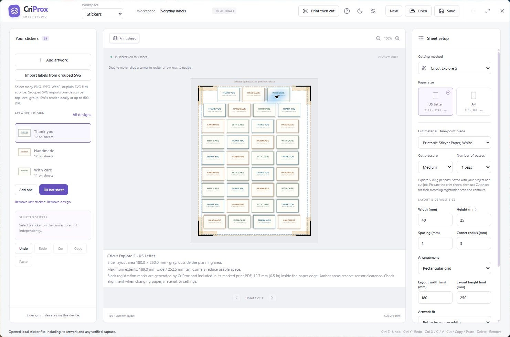

- Select many PNG, JPEG, WebP, or plain SVG files in **Add artwork**. Files are placed automatically
  in natural filename order. Each imported sticker has its own size and placement. SVGs use their
  physical dimensions when supplied; raster images preserve aspect ratio using the default width. SVG drawings render locally at
  up to 600 DPI. Text converted to paths gives the most predictable appearance.
- **Import labels from grouped SVG** separates one top-level group per label. This supports an
  existing sheet of individually grouped designs without requiring you to export each label first.
  Scripts, external resources, embedded images, and unsupported SVG constructs are rejected.
- Select a sticker on the canvas and drag it to move, drag its corner to resize, or enter exact
  millimeter coordinates and dimensions. Rotate by any angle, mirror horizontally, flip vertically,
  change corner radius, duplicate, delete, and undo/redo edits. Arrow keys nudge by 1 mm; Shift uses 10 mm.
- Click a library design and press **Delete** to remove it and its sheet copies, even if it has zero copies. Right-click a design (or use Shift+F10) for Edit, Rename, Duplicate, Cut/Copy/Paste, Add one, Fill, **Delete all copies**, **Delete design**, and **Delete all designs**. Deleting copies keeps the library design; deleting all designs clears the library and sheets. All these edits support Undo/Redo. Library clipboard actions copy editable artwork; sheet clipboard actions copy individual placed stickers.
- **Keep entire image** preserves the source image. **Trim empty space — keep artwork** removes empty white/transparent margins and then fits the complete content inside the cut; it replaces the old destructive Crop to fill behavior, including in saved projects. For imported stickers, **Border width** adds white padding and **Border stroke** adds an optional printed line with a custom color (0 mm disables it). Rounded corners reserve enough room to avoid clipping image corners. Custom designs keep their own artwork/cut coordinate system and are edited in the designer. Border settings save with the project and appear in both preview and print output.
- **Auto arrange** packs individual sizes across sheets while preserving their rotations and flips, staying inside machine limits and clear of registration corners. Use it to repair an older layout that crosses the guides.
  Manual overlap is flagged because merged silhouettes can change Design Space cuts.
  Auto arrange and Fill run in a background worker with progress and **Cancel layout**. Cancelling keeps the original project. Matching ovals and convex outlines use bounded contact searches; complex nesting has a six-second search budget and can use the safe grid result instead. A 20-second watchdog stops an unresponsive worker without replacing the sheet.
- **Fill last sheet** repeats the selected design into the remaining slots, or cycles through the
  imported designs when **All designs** is selected. Import, Auto arrange, and Fill share the same machine-aware placement search. Fill keeps existing positions and adds stickers only in clear space; it tries smaller designs when the next design will not fit. Existing stickers keep their order. A full sheet
  is unchanged; **Add one** starts another sheet when needed.
- Choose a rectangular grid or tapered rows. The layout compares both uniform orientations and
  picks the one with the most slots. Width, height, gaps, corners, and layout limits are in millimeters.
- **Save** and **Open** use portable `.stickers.criprox.json` files containing all artwork,
  ordered sticker instances, individual positions and transforms, settings, and any captured registration PDF. A separate local draft is
  autosaved on this device. Sticker files open in the sticker workspace, not the card project library.
  **New** starts a fresh sticker draft after reminding you to save the current one.
- **Export artwork + cut reference** creates a ZIP containing PNG sheets, matching SVG cut references,
  a millimeter position CSV, and Design Space instructions. Transparent gaps and opaque white sticker
  interiors produce one rounded outer silhouette per label. Freeform contour tracing and bleed are
  not included. Partial PNG sheets have explicit occupied-artwork dimensions in the instructions.
- **Prepare print sheets** prints all corner marks and the arrow locally for fixed or freely arranged stickers, on every sheet. **Save PDF + matching cut job** includes the matching page coordinates. No capture is required.
- **Save setup PNG**, **Capture Design Space PDF**, and **Save print PDF** provide experimental
  reuse of a measured, fixed-slot template capture. This is an optional Design Space workflow;
  changing any individual sticker clears the old capture to prevent mismatched cuts. Reopening a project re-measures its saved PDF;
  geometry and paper changes invalidate the capture. Printing replaces each slot individually so
  captured marks in empty tapered corners remain intact. Partial registered sheets still cut every
  slot in the saved full-template Design Space job, including blank slots.

Limits: 500 designs/placed stickers, 10 MB per input image or SVG, 50 MB of embedded image data,
25 MB per capture PDF, 90 MB per project file, and 24 sheets per print/export job.

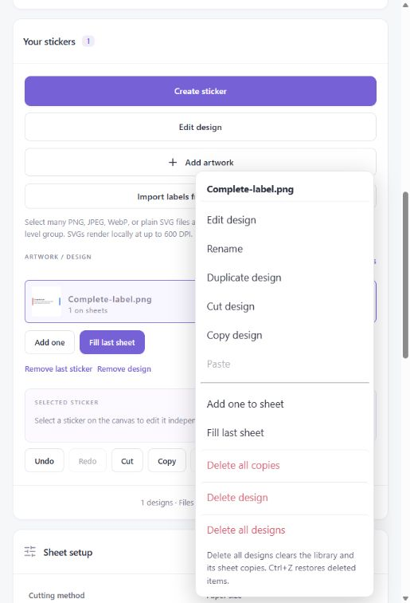

## Design stickers in the app

Choose **Create sticker** in the left panel, or select a design and choose **Edit design**. The designer uses the same three-panel workspace: elements and selection on the left, canvas in the center, and design setup and layers on the right.

- Add multiline text with font, size, bold, alignment, fill, and outline controls. Add rectangles, ellipses, triangles, diamonds, stars, hearts, or hexagons, and embedded PNG/JPEG/WebP images.
- Choose Essentials, Pastel, or Earth palettes, or custom colors. Adjust fill, line color, line width, and opacity. Drag with **Line** or **Freehand** to draw; select a stroke to edit its width and color.
- Select and drag elements, resize with the small corner handle or exact dimensions, rotate, mirror, flip, duplicate, and reorder layers. Undo/redo, cut/copy/paste, and Delete work inside the designer; text inputs retain normal editing shortcuts.
- **Save design to sheet** trims the sheet image and dimensions to the outer cut bounds while keeping the full canvas and layers editable. Artwork outside closed outlines becomes transparent, so nested stickers cannot cover each other. Editing a saved design updates every copy, preserving its scale and adjusting its dimensions to the new cut bounds. Designs with only open lines keep the full canvas. Portable project files retain editable layers and a print-ready raster, rendered locally at up to 600 DPI (24 megapixels maximum).
- **Fill last sheet** and **Auto arrange** use closed cut shapes for collision checks, allowing circles to stagger and irregular shapes to share rectangular bounds. Spacing is measured between shapes; machine limits and reserved corners still apply. Fill preserves existing copies and compares nesting against the grid to keep the larger count. Existing designs adopt trimming when you edit and save them again.
- **Show cuts** highlights the actual blade paths in pink without printing them. In the designer choose **Editing → Cut paths** to add shapes, straight cuts, freehand outlines, or polygons. Custom paths replace the default rounded-rectangle cut and follow every copy’s size, rotation, mirror, and flip. Use **Element use** to turn a printed shape into a cut or back again. Automatic tracing of imported image edges is not included.

**Fit Cut** in the designer fits one rounded enclosing outline around visible artwork. Set **Border width**, **Border stroke**, and stroke color on the same page, then apply Fit Cut. It preserves artwork beyond the old canvas, expands the canvas when needed, and replaces earlier custom cuts with one outer outline. Gaps between separate elements are enclosed within that sticker. The optional border stroke becomes an editable printed layer; the cut remains a separate blade path. Re-fitting replaces the generated border rather than accumulating copies.

Drag the **Layers** rows to reorder them; the top row is in front. Bring forward/Send backward remain available, and each drag is one undoable edit. Selection uses a thin dashed grey box and small handle; **Show cuts** uses thin dashed pink guides. Their visible line widths stay constant as you zoom.

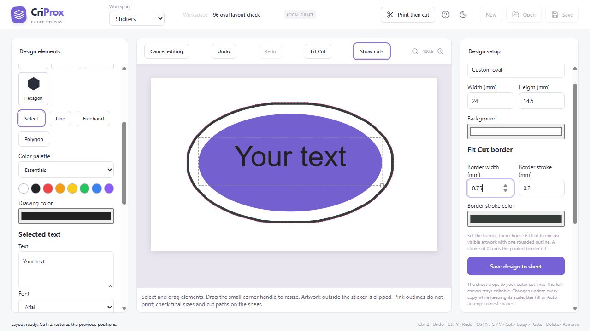

Use **Polygon** to click corners and **Finish outline** to close them; **Freehand** closes a cut outline automatically, while **Line** creates an open cut. Drawn paths offer a **Close path** checkbox and editable vertex coordinates. Shapes can be moved, resized, rotated, and mirrored; rectangles also have a corner radius. **Add default outline** creates an editable rounded rectangle, and **Use default sheet cut** removes custom paths. Separate custom shapes remain separate cuts; there is no automatic union.

Keep cut paths inside the sticker canvas. Custom designs always fit their complete saved artwork and cut paths inside the sheet placement. Custom paths use CriProx’s generated-mark workflow; captured rectangular templates and Design Space image handoff cannot preserve separate blade paths. Native plot construction passed for a concave star, an open polyline, and an ellipse without accessing hardware. The new custom shapes still need a physical cut check.

Designs allow 100 elements on a 10–250 mm canvas. A custom cut sheet supports up to 2,000 paths and 200,000 points; the exported job must stay below 8 MB. Images share the project’s total artwork limit. Save the design to the sheet before closing the app or saving a portable project; unfinished designer changes are not autosaved.

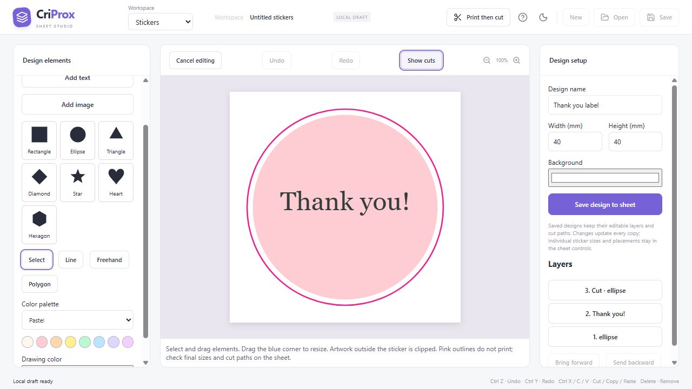

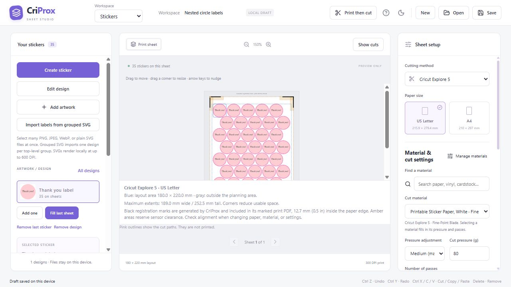

## Connect and print then cut

Both workspaces have **Print then cut** with preparation, actual-size printing, mat setup, and cutter
connection steps. Cards and stickers generate marked PDFs with matching cut-job files locally, including partial sheets and individual sticker transforms. Card backs retain manual-refeed or duplex order. The optional capture workflow remains available for saved Design Space jobs.

Windows desktop builds connect to Explore 5 over USB (recommended) or experimental Bluetooth LE.
Opening **Print then cut** in either workspace automatically attempts one connection with an available
saved key, using the last selected transport. Home and editing pages do not initiate connections.
If no usable key is available, **Open Cricut Design Space** starts setup: sign in and connect the
cutter there, close Design Space, then authorize remembering the key and choose **Connect cutter**.
That explicit setup connection uses its signed-in session to request a key from Cricut's official endpoint.
After a verified handshake, CriProx saves the key encrypted for your Windows account. Later connections
try that saved key without opening Design Space or requesting another key online. Login tokens are
never saved by CriProx. The inspected Design Space **10.8.81** runtime is still required; unrecognized builds are rejected.
Status shows authenticated connection, firmware, and carriage state. **Disconnect** releases the cutter.
While disconnected, **Forget saved key** removes the stored key; the next connection needs a current
Design Space sign-in. A failed saved-key handshake removes that key and shows the setup prompt.
Automatic connection never reads the account session or requests a replacement key. **Disconnect**
stays disconnected until you connect manually or revisit the cut page. Connection alone never starts
a cut. If Windows protection or saving is unavailable, cutting can still use an in-memory
key and the connection message explains that it was not saved. Saved-key lifetime across cutter
power cycles and long periods remains unverified; this feature does not extend Cricut's token expiry.
Windows protection prevents other Windows accounts from decrypting the stored key; it does not
isolate it from other software running as your Windows user. Keys are not included in project exports.
**Cut sheet** runs the matching prepared sheet; the old square-test interface has been removed.

USB authentication, firmware **4.8.2**, idle status, and blade-free homing have succeeded on the
physical Explore 5. A one-pass 80 g square cut was confirmed cleanly. **A complete Explore 5 USB sticker sheet scanned and cut successfully at 80 g, one pass; the user confirmed usable stickers.** The Windows app now submits native registration scans and matching sheet contours, with Pause, Resume, and Cancel cut controls. A failed scan cancels the job. Generated files must not be cut with an unrelated Design Space mat. BLE reconnection, A4 placement, other materials and cutter models remain unverified.

Browser, macOS, and Linux builds retain local sticker editing and exports but cannot connect to
the cutter. See the [print workflow](CRICUT-WORKFLOW.md) and
[direct-control investigation](EXPLORE-5-INTEGRATION.md).

## Workspaces, shortcuts, and machine guides

Use the **Workspace** dropdown in the main window to switch between **Home**, **Proxy Card Builder**, and **Stickers**.
Both share panel styling, machine and paper controls, zoom buttons, sheet navigation, and undo/redo history logic. Each keeps its own local draft, selection, and edit history while you switch; stickers no longer open in a dialog.
Both editors have **Show cuts** above the sheet. In Proxy Card Builder it overlays each placed card's rounded cut contour on the artwork, including rotated cards and partial sheets. The thin dashed pink guides keep a constant visible line width at any zoom and do not appear in printed output. Captured-template previews use the captured page's artwork origin.

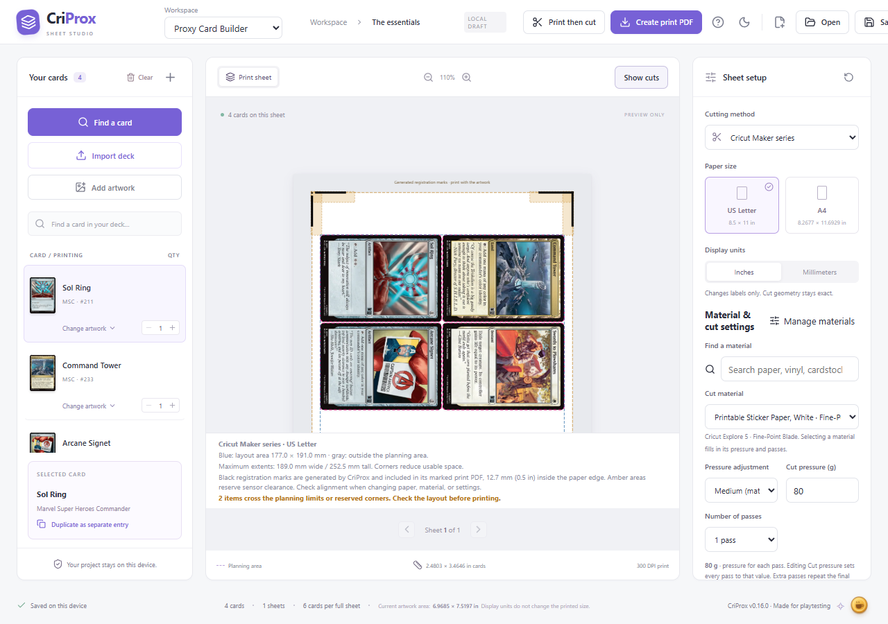
In either workspace, **Ctrl+Z** undoes, **Ctrl+Y** (or Ctrl+Shift+Z) redoes, and **Ctrl+X / Ctrl+C / Ctrl+V**
cut, copy, and paste the selected item. On macOS use Command. Text fields retain normal text-editing shortcuts.
**Delete** removes the selected card copy or sticker; Undo restores it without changing the item clipboard. In Stickers, selecting a design in the left-hand library and pressing **Delete** removes that design and all its sheet copies, including designs with no placed copies. Selecting a sticker on the sheet deletes only that copy. Text fields retain normal Delete behavior.
Item clipboards are local to each workspace and this app session; they do not copy images into the system clipboard.
Card cut/copy operates on one selected copy. Pasting a sticker preserves its size, rotation, mirroring, and embedded artwork.

Choose your machine and paper in either workspace. The full-page preview shows a blue layout boundary,
gray margins, amber reserved corners, and alignment-mark locations. Explore 5, Explore series, Maker series,
and Joy Xtra share the published Letter/A4 maximum extents; selecting a model does not imply direct connection support.
Manual / Basic Cut layouts and card backs omit optical marks because they do not use sensor registration.
Uncaptured previews show the same black marks generated in the print PDF; matching captures show their original marks.
Amber clearance and blue layout outlines remain editing guides and do not print.

The [published Cricut limits](https://help.cricut.com/hc/en-us/articles/360009429814-How-large-can-I-Print-Then-Cut)
are maximum horizontal and vertical extents, not a fully usable rectangle. Generated marks use measured
25.4 mm arms, approximately 1.5 mm thickness, a fixed 12.7 mm (0.5 in) page inset, and 6.35 mm sensor clearance.
The preview and generated PDF keep that inset even for dense layouts. Export rejects
artwork covering marks or leaving the page and warns about clearance. Eight full-size cards on Letter
overlap the generated marks; use A4 or another layout.
Automatic placement also checks machine bounds and reserved corners. Captured templates retain their original fixed-slot geometry.

Machine changes preserve sticker sizes and positions and invalidate mismatched captures. Generated PDFs
and their cut-job file use one shared page frame; Design Space can position marks differently. See the
[generated-print workflow](CRICUT-WORKFLOW.md#generate-registration-marks-in-criprox).

## Material manager, pressure, and passes

Cards and Stickers share **Manage materials** in sheet setup and **Print then cut**. The desktop
app automatically imports locally cached Design Space materials on first use. **Refresh from Design
Space** brings in newly cached profiles without overwriting your CriProx edits. The import reads
material settings only and never changes Design Space files. The available catalog depends on the
machines and materials cached by your Design Space installation; it does not download Cricut's entire
online catalog. If nothing is cached, open Design Space, select your machine, browse its materials,
and refresh in CriProx.

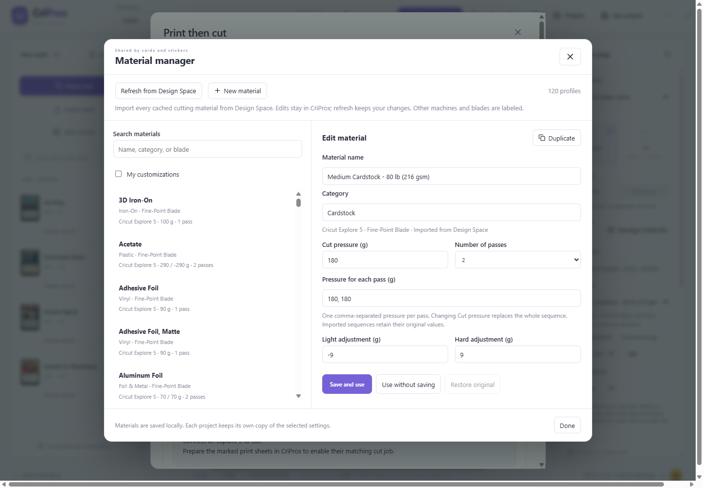

Search by name, category, machine, or blade. Selecting a material fills in its default pressure and
number of passes, and resets the pressure adjustment to Medium. For example, the inspected Explore 5
medium 80 lb cardstock profile uses 180 g and **two passes**. White sticker paper uses 80 g and one pass.
Light/Medium/Hard applies the material's own pressure adjustments. **Cut pressure (g)** changes the
pressure for every pass in the current project; **Number of passes** accepts 1–10. Extra passes repeat
the final pressure. Imported profiles retain different pressures on individual passes, such as
250 / 150 g for laminated sticker paper.

In the manager, **New material** creates a custom Explore 5 fine-point preset; **Duplicate** copies
an existing profile with its machine and blade. Edit the name, category, pressure, passes, individual
pass pressures, and Light/Hard adjustments. **Save and use** saves the preset locally and applies it
to the current project. **Use without saving** applies a project-only copy. **Restore original** removes
an override; **Delete custom** removes a custom library entry. Existing projects keep their own
settings even after a library edit, refresh, restore, or deletion. Select the material again to apply
its current library defaults. The library is shared by both workspaces on this installation; selected
settings travel with portable card/sticker projects and generated cut jobs. Browser users can create
custom presets but cannot import another application's local cache.

Machine and blade requirements remain attached to each profile. All cached material names are visible,
including deep-point materials. Direct cutting currently accepts only Explore 5 fine-point profiles
with positive pressures up to 450 g. Profiles needing another blade, machine, or an unsupported pressure
sequence remain available for reference and Design Space use; CriProx blocks direct cutting for them.
The local catalog checked during development contained 116 materials / 118 blade profiles. All 109
compatible profiles built native plots with the exact imported pressure sequence in offline tests;
this does not establish physical cut quality for those materials. Cut settings never change artwork
size or registration marks. Older projects retain their existing pressure and pass count.

In **Print then cut**, prepare and print the marked sheets, connect the Explore 5, select the printed front page, and confirm its placement and blade before **Cut sheet**. Loading the mat starts measurement, registration scanning, and then the matching contours. The job uses an immutable snapshot of pressure, passes, and geometry; changing the project cannot change an active cut. Pause/Resume and Cancel remain available while the workflow is open. Closing CriProx requests cancellation and disconnects.

An Explore 5 USB test at Medium (80 g) and one pass cut a sticker-paper square cleanly. A full printed sticker sheet also scanned and cut successfully at 80 g, one pass. Other forces, cardstock, multiple passes, A4, and repeatability still need physical testing. When using Design Space, apply settings there separately.

## Direct printing and detailed previews

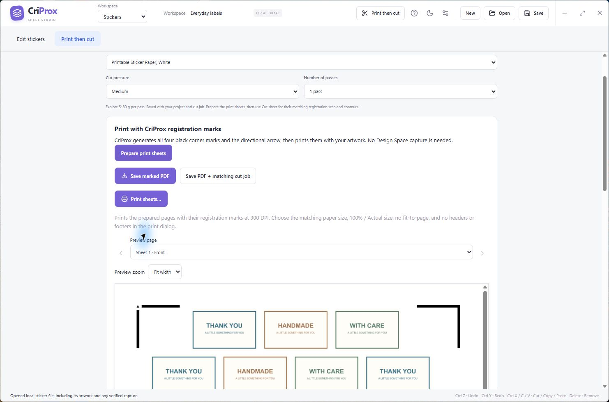

Prepared PDFs have **Print sheets**, **Print fronts / Print backs**, or **Print double-sided** buttons. The desktop app opens CriProx’s own **Print preview**, showing the exact prepared page images with page navigation and zoom. Choose a printer, 1–99 copies, color or black and white, page range, and duplex, then choose **Print**. Physical page dimensions, zero requested margins, and 100% scale are requested. **System printer settings** opens the optional advanced driver dialog; Windows may not show an image there, so the CriProx preview remains the visual reference. Cancelling the advanced dialog returns to the preview. Direct printing renders the prepared PDF at 300 DPI, including its marks; PDF export remains available at the project's chosen resolution. Select the matching paper size and Actual size in the printer driver. Duplex requests use the selected binding; manual refeed prints the two files separately. Browser printing uses the browser dialog and requires setting duplex there.

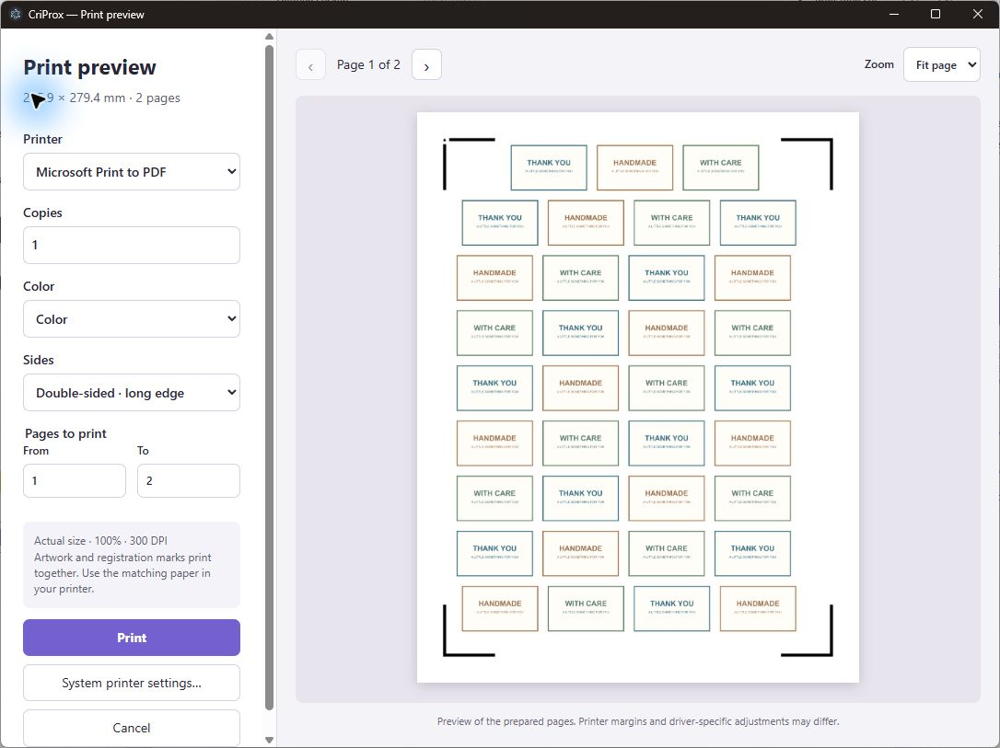

The PDF preview renders for the current panel width and display pixel density. **Preview zoom** offers Fit width, 150%, 200%, and 300%, with scrolling for small label text. Zoom affects only the preview, not print dimensions or artwork quality. Low-resolution source artwork still limits detail.

## Card and artwork sources

- Import a public or unlisted Moxfield or Archidekt deck link, preserving selected printings when available.
- Paste a deck list and resolve cards through Scryfall.
- Search the Scryfall card catalog by full or partial name and add cards one at a time.
  **Find a card** focuses the search box when it opens, so you can start typing immediately.
  Pop-ups that close on outside clicks stay open when you select text or drag from inside and
  release outside. Clicking outside still closes them.
- Choose **Find a card → Browse sets** to browse all paper sets, including token and supplemental
  sets. Filter by set name or code, and list sets newest first or alphabetically.
- Browse every available printing in a selected set, sorted by collector number, name, color,
  rarity, mana value, or artist in ascending or descending order. Sorting applies to the entire set;
  **Load more cards** continues in that order. Adding a card keeps the chosen printing, and repeat
  additions increase its quantity without replacing other printings of the same card.
- Choose **Find a card → Commander precons** to browse individual preconstructed Commander decks
  from MTGJSON. Filter by deck name or set code, and sort newest first or alphabetically.
- Open a precon to see its exact Scryfall printings, commander labels, and included quantities.
  Add individual cards or use **Add deck** to add all commanders and mainboard cards with their
  quantities, including basic lands. Tokens, display commanders, and other supplemental cards are
  excluded. Whole-deck additions require every printing to have artwork and enough room within
  the 500-card project limit; unavailable printings are listed with a retry option.
- Choose **Find a card → Tokens** to browse paper token printings, newest first by default.
  Search by token name, optionally narrow to a token set code such as `TMH2`, or leave both
  filters empty to browse all tokens. Sort by release date, name, set/collector number, color,
  or artist in either direction; **Load more tokens** continues in that order.
- Add the exact token artwork shown, including double-faced tokens with their matching reverse
  artwork. Repeated additions increase that printing's quantity within the 500-card project limit.
- Start with four example Scryfall card records in a new workspace.
- Search loaded cards and filter printings by set and collector number.
- Select either face of a double-faced card from the inspector.
- Search MPC Autofill community artwork and browse its dedicated card-back collection.
- **Sort artwork**, beside the MPC Autofill search box, defaults to **DPI: highest first**, with
  options for lowest DPI, name A–Z or Z–A, and recently updated artwork. DPI sorting covers loaded results;
  **Load more** adds results and reorders the combined list. Name and update sorting apply to the
  full search. The same controls are available for card fronts, tokens, and shared card backs.
- Trim MPC Autofill's native print bleed from fronts and card backs so the finished-card area fills
  the 63 × 88 mm cut; when output bleed is enabled, reuse the source artwork outside that trim.
- Import local PNG, JPEG, or WebP artwork up to 20 MB per file.
- Detect MPC-style print-canvas proportions in uploaded fronts, reverse faces, and shared card backs,
  with a per-face toggle to correct the suggestion when custom artwork uses a different layout.
- Keep the complete card interior opaque, even when the source image contains transparent pixels.

Deck-list requests are batched in groups of at most 75 unique identifiers. Request starts are serialized with at least 120 ms between them and at least 500 ms between card-search requests, and a `429` response stops the operation instead of continuing to pressure the service.

Precon browsing needs an internet connection on first use. MTGJSON catalog and decklist responses
and complete Scryfall printing lookups are cached for one day. Catalog coverage follows MTGJSON;
newly announced products may not have decklists or artwork yet.

## Sheet design

- Standard 63 × 88 mm card dimensions with a 2.5 mm corner radius.
- 1 mm spacing in the standard layout profiles.
- US Letter and A4 planning modes.
- Millimeter-based placement and vector geometry shared by preview and export.
- Print-sheet preview with captured Cricut registration marks when available, sheet pagination,
  and zoom controls.
- Click a card on the sheet to open its artwork preview. Placed cards cannot be dragged or
  dropped back onto the sheet as new artwork; external image files can still be dropped to add them.
- Right-click a card on the active sheet for **Change Artwork**, **Duplicate**, or **Fill Page**.
  Duplicate inserts one copy immediately after the clicked card, moving overflow onto the next
  sheet. Fill Page fills only the active sheet's empty slots and keeps its existing cards.
  Both actions preserve the clicked copy's exact artwork and selected face. Fill Page is disabled
  on a full sheet or when filling it would exceed the 500-card project limit; Duplicate is disabled
  at that limit. Focus a card and press **Shift+F10** or the context-menu key for keyboard access;
  use arrow keys to choose an action and **Escape** to dismiss the menu.
- Choose **Delete Card** in the card's right-click menu to remove that copy. An **Are you sure**
  popup names the card and asks you to confirm with **Delete card**. **Cancel**, **Escape**, or
  clicking outside keeps the card. Other copies remain in the project.
- Scroll the mouse wheel over the sheet to zoom. Drag empty space on or around the sheet to pan,
  or hold the right mouse button and drag anywhere, including over a selected card. Panning moves
  only the preview; normal left-clicks on cards still select them or open their artwork preview.
- 300, 600, 900, and 1200 DPI output.
- Optional playtest label along the bottom edge.
- Size-check card with a 5 mm measurement grid.
- Collapsible sections in **Create print PDF** keep reviewed print options, card backs, and
  one-time setup compact. Choose **Done** to collapse a reviewed section into a summary with a
  green check; click its header to reopen it at any time. Completion is remembered locally for
  the exact machine, paper, and cut geometry. Relevant settings or artwork changes reopen the
  section for review. A verified captured template automatically completes both setup sections;
  physical calibration is marked done only when you confirm it yourself.
  Settings, setup, and reminders appear above the prepare controls, followed by the PDF preview.

The selected DPI controls export density; it cannot add detail absent from the source image. The 900 and 1200 DPI modes are intended for high-resolution MPC Autofill or custom artwork and use substantially more memory.

The print PDF dialog also offers **Upscale Scryfall card images (high detail)**. It is off in the factory defaults and applies only when preparing card sheets, including matching reverse faces. You can choose the built-in 4× ESRGAN Thick engine, which downloads a ~28 MB model from a package CDN, or an installed [Upscayl desktop app](https://upscayl.org/download). The Upscayl option uses **Ultramix (Non-Commercial)** at 4× and appears when CriProx finds its bundled command line engine and Ultramix model in a common installation location. The Ultramix model is marked for non-commercial use by Upscayl. CriProx passes temporary PNG files to the engine and deletes them after processing; the work remains local. Enhanced images are cached separately by engine and model version. Choose 600 DPI or higher in Sheet setup to retain the extra detail in the PDF. MPC Autofill and uploaded artwork keep their original pixels. The original Scryfall image remains available by turning the option off. Upscaling can take much longer than a standard export and may change fine text or illustrated detail, so inspect the PDF before printing. Upscayl requires a compatible GPU. Size-check and alignment pages do not run either engine.

## Export packages

Use **Create print PDF** for finished card-sheet PDFs that you print from a dedicated PDF
application and cut with a reusable saved Design Space project. The separate **Export** package
provides artwork and geometry for the alternative direct PNG workflow and can include:

- Transparent artwork PNGs with one opaque, rounded silhouette per card.
- Matched vector-only SVG silhouettes with the same size, origin, positions, rotation, and corner radii.
- A dimensions manifest for exact Design Space canvas sizing.
- A plain-text Design Space handoff guide.
- A ZIP containing multiple sheet outputs.

PNG physical-density metadata is included. Pixel rounding is limited to at most half a pixel per overall dimension—about 0.042 mm at 300 DPI—but downstream tracing, printer scaling, paper feed, cutter calibration, and material behavior introduce their own error.

The SVG is a geometry reference or a separate Basic Cut template. It is not a registration mechanism. Enabling its paths together with the PNG's traced contours can create duplicate cuts.

## Registered printing

**Prepare print sheets** creates marks locally for card and sticker sheets, with matching cut coordinates. No capture is required. Direct scanning and cutting of these generated sheets remain under development.

The following describes the optional **Reuse a captured Design Space job** route. **Print its PDF and cut with its exact saved Design Space project.** Set up and save the cut template
in Design Space once, save its print output as a one-page PDF, and import that PDF into CriProx.
CriProx recognizes the surrounding marks and places current artwork into the captured template
without changing the saved cut geometry. For later decks, save the finished PDF from CriProx,
print it from a dedicated PDF application, and reuse the matching saved Design Space cut project.

- Front and back bleed are independent toggles.
- Front bleed and the bleed between card backs are fixed at 0.5 mm for six-card and eight-card sheets and
  0.05 mm for seven-card sheets. Back sheets extend artwork 1.5 mm past exposed outside edges to
  hide small front-to-back alignment shifts.
- The captured PDF must correspond to the exact saved Design Space cut job.
- The desktop app stores verified six-cut, seven-cut, and eight-cut captures as PDFs at the root of the selected
  CriProx project library and loads them automatically whenever their exact cut geometry is selected.
  Existing captures in local app storage are copied into the library on first use.
- This optional route preserves the captured marks. The primary generated-PDF route creates marks independently.
- CriProx saves the finished PDF instead of printing it through the browser, which would rasterize
  and reduce higher-resolution output. Print the saved file from a dedicated PDF application at
  **100% / Actual size** with fit-to-page/shrink-to-fit disabled.
- In Design Space, reopen the exact saved project and mat, choose **Already Printed / Skip printing**
  when available, and cut the printed sheet front-side up. Keep the cut geometry and mat arrangement
  unchanged; changes to paper, spacing, machine, layout, or the saved cut job require a matching new capture.

See [Cricut workflow and physical validation](CRICUT-WORKFLOW.md) for the complete setup and reuse procedure.

## Manual nine-card cutting

Choosing **Manual cutting** in the machine menu automatically selects the nine-card layout. The
portrait Letter or A4 PDF centers the nine-card block. The sheet editor previews configurable
vector guides before PDF generation: separate card and page colors, stroke width, placement, card corner or full outlines,
solid or dashed lines, square or round corners, corner-guide length, and page-edge or full-page
cut lines. Guides can also be disabled. Front PDFs use the same geometry as the preview; back
pages remain artwork-only. Print at 100% / Actual size and check one card with a ruler before
cutting a full sheet.

For registered Cricut layouts, the sheet editor shows the saved Design Space page and places cards
at the same origin used by PDF export. Partial sheets keep the full layout's occupied-slot positions.
The eight-card preview applies the same Tabloid-to-Letter or Tabloid-to-A4 translation as export. Before a matching
capture is available, the editor shows the same mark geometry as generated PDF output.

For Cricut machines, the existing experimental manual alignment profile uses the same nine-card
geometry with a separate Basic Cut file:

The experimental manual profile fits nine fixed 63 × 88 mm cards in a 191 × 266 mm 3×3 block
with 1 mm gutters. It produces:

- Portrait Letter or A4 print PDFs with the artwork block nominally 6.35 mm (0.25 in) from the top
  and left before physical calibration.
- One transparent 300 DPI PNG containing the same nine rounded silhouettes for Basic Cut.
- Fixed slot positions on partial pages, allowing one saved Design Space cut project to serve every
  page in a deck.
- Saved horizontal and vertical physical-cut corrections from -5 mm to +5 mm. Corrections shift the
  print PDF in the opposite direction, so the Basic Cut PNG and saved Design Space project stay fixed.
- A plain-paper calibration PDF with 1 mm measurement grids around the top-left card. The guided
  controls convert the observed blade-line direction and square count into the required correction.
- Matching manual-refeed or duplex back pages when card backs are enabled.

This mode uses no sensor marks. The printed page must be placed flush to the upper-left of the mat's
adhesive grid, while the Basic Cut group starts at the first 0.25 in inset in Design Space's Prepare
preview. Printer scaling, page placement, mat loading, and machine repeatability remain physical error
sources, so this mode requires a measured plain-paper test.

## Card backs and duplex output

Card backs are optional and disabled in the factory defaults. Selecting a double-sided card shows a warning while
backs are disabled. When backs are enabled, each double-sided card automatically uses the face opposite
its selected front in the matching mirrored back position. A shared back is used only for single-sided
cards, including on a mixed sheet. Back pages can be exported as:

- Separate front and back PDFs for manual refeed.
- Alternating duplex pages.
- Long-edge or short-edge orientation.
- X/Y alignment offsets for a repeatable printer shift.

Back pages contain artwork only. Alignment controls can compensate for a consistent offset, but not irregular feed variation from sheet to sheet.

## Local projects and caching

- Dialogs use the available window height on larger displays. Projects shows more saved projects
  before scrolling, Settings has more room for defaults and release notes, and artwork choices
  can grow taller. Dialogs stay within the window, with Projects and Settings controls kept visible
  while their content scrolls; shorter dialogs stay compact.
- One autosaved workspace stored in IndexedDB.
- Settings opens directly to **New project defaults**, with editable **Sheet**, **Print**,
  **Card backs**, **Cut guides**, and **Alignment** groups. Configure paper, machine, layout,
  display units, DPI, bleed, labels, upscaling, shared artwork, refeed or duplex
  options, manual guides, and measured alignment corrections without changing the open deck.
  Card dimensions, corner radius, and spacing are managed by the selected layout and cannot be
  edited in Settings. Incompatible machine or paper changes select an available layout automatically.
- One draft keeps edits across Settings pages and groups. **Save defaults** saves all groups at
  once for future projects. Select **Also apply to current project** to save and apply the setup
  to the open deck while keeping its name and card list. The footer stays visible while scrolling.
- **Use current project** copies its setup into the draft; **Reset to factory** prepares factory
  defaults for review. Neither changes saved defaults until you save. **Undo changes** restores the
  saved setup. Closing with unsaved edits offers **Keep editing** or **Discard changes**.
- The **Card backs** group lets you upload, preview, replace, remove, or browse shared artwork and
  review source-bleed trimming. Disabling backs retains the artwork and print options. Upscaling
  choices persist with each project and stay selected when reopening the print dialog; an
  unavailable saved Upscayl engine is flagged so you can choose another engine.
- **Appearance** and **Project library** have their own Settings pages. Theme and folder changes
  apply immediately and do not discard an unfinished defaults draft.
- A desktop project explorer backed by the app's private Application Support directory by default.
- A one-time macOS importer for projects created in the earlier `Documents/CriProx` library.
- A configurable projects folder, with each saved project and its artwork kept together.
- Nested library folders (up to eight levels), clickable breadcrumbs, and **Show current** to
  jump to the open project's folder. Use **New folder** to organize decks by format or collection.
- Saved decks use a card-stack icon, while library folders use a folder icon so they are easy
  to distinguish at a glance.
- Empty folders have a **Delete empty folder** action. Folders containing projects, subfolders,
  or any files (including hidden files) cannot be deleted from the explorer.
- While viewing an empty folder, **Delete folder** appears beside **Back to library**. Deleting
  the folder returns you to its parent, so you can clean up without leaving the empty view first.
- Search across the entire library by project or folder name, even while browsing a subfolder.
  **All projects** shows every saved deck; sort by **Recently saved**, **Name A–Z**, or **Most cards**.
  A single **Clear library search** button clears the filter and keeps focus in the search field.
- **Move to folder** relocates a saved project and its artwork together. Same-named project folders
  receive a unique suffix, and moving the open project updates where future saves go.
- Choose **＋ New folder…** in the destination dropdown to name a folder inside the selected
  destination, then **Create & move** to organize the project in one step.
- Drag a saved project onto a folder row or a breadcrumb (including **Library**) to move it.
  Available destinations highlight while dragging, with a stronger highlight over the drop target.
  Projects can also be dragged from search results or **All projects**; the **Move to folder**
  button remains available for keyboard and touch use.
- Scroll with the wheel while dragging a deck, or hold it near the top or bottom of the list
  for gentle automatic scrolling. Moving away from the edge, dropping, or pressing Escape stops
  scrolling; on narrow windows the explorer's content scrolls to reveal more folders.
- Unsaved projects can be saved into the folder being browsed. Existing projects keep their saved
  location until moved explicitly.
- Uploaded artwork materialized in the saved project’s `assets` folder.
- Project deletion moves the complete project folder to the operating system Trash for recovery.
- Portable JSON backups that include local artwork and selected remote URLs.
- Successful API responses cached for one day.
- Find Card preview images cached locally by their complete image URL, shared across searches,
  sets, and sort orders. Cached previews survive app restarts. Only visible and nearby cards load
  previews, with at most four loads at once. The preview cache retains up to 1,024 images within
  128 MiB on disk and 32 MiB in memory, evicting older images as it fills. If local storage is
  unavailable or full, previews still load and use the session cache.
- Export artwork cached for reuse.
- No account, telemetry service, hosted backend, or cloud project sync.

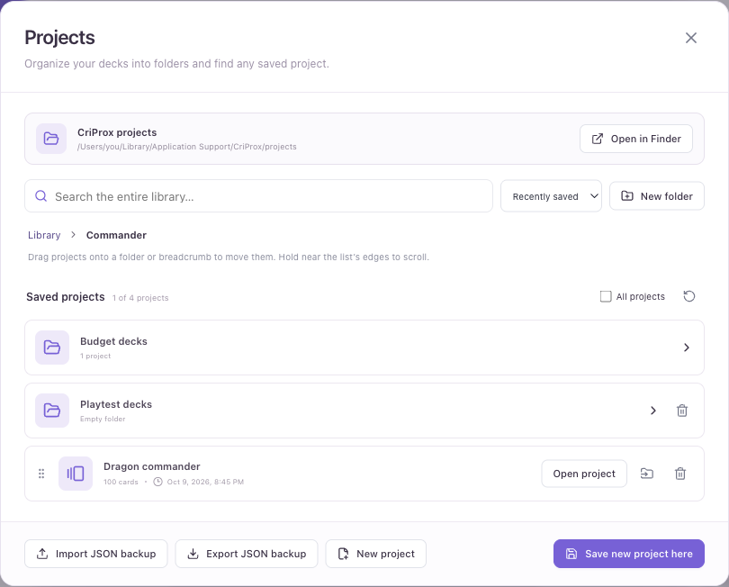

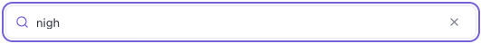

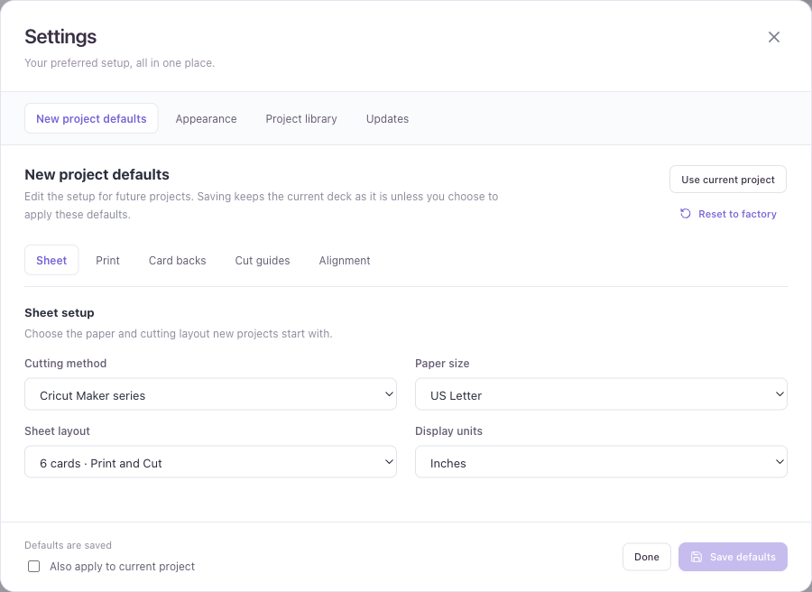

Remote URLs in a project backup are references, not embedded copies of the remote files. Browser or application storage can be cleared or reach its quota, so a downloaded project backup is the durable copy.

## Desktop updates

- Checks for newer stable GitHub releases on startup, with **Review update** opening
  **Settings → Updates**. **Check now** runs a fresh check and shows the last successful check.
  Connection failures offer a retry rather than reporting that the app is up to date.
- Release notes use the website’s changelog presentation: version and date beside a readable
  headline, **New**, **Improvements**, and **Fixes** categories with icons, formatted lists,
  emphasis, inline code, and working issue and guide links. Commit hashes and duplicate entries
  are removed. Markdown is sanitized before display; remote images and executable content are
  excluded. A GitHub link opens the full release.
- **Changelog** stays visible in **Settings → Updates**, including when you’re up to date.
  Releases appear newest first; versions newer than your app are labeled **New**, and your
  current version is labeled **Installed**. The release history shipped with CriProx is readable
  offline, and update checks refresh it with published stable releases. A failed check keeps
  the available notes visible.
- Downloads the published package for the running platform and architecture, with progress,
  cancellation, retries, and SHA-256 verification using the release’s checksum file. Failed or
  incomplete downloads are removed; the file is verified again before opening it.
- **Install update** saves the active workspace, opens the macOS DMG or Windows installer,
  and closes CriProx automatically. On Linux, choose a permanent location for the AppImage;
  CriProx saves it, makes it executable, launches it, and closes the current copy. Canceling the
  location picker or failing to launch keeps CriProx open.
- macOS has a short unblock-command section directly below the download controls and above the
  release notes, with **Copy command** and **Open Terminal** buttons.
  Paste and run the command after replacing the app in Applications if macOS blocks it.
- **Remind me later** snoozes that version’s notice for 24 hours and leaves a small **Update
  available** button beside the donation button in the bottom bar. It opens **Settings → Updates**
  and changes to **Update ready** after the download is verified. A newer release gets its own
  notice, and the main notice returns when the snooze expires.
- Downloads continue when Settings closes. Download state lasts for the current app session;
  macOS still requires dragging the app into Applications, and Windows setup remains interactive.
  Unsigned-app warnings may still apply.

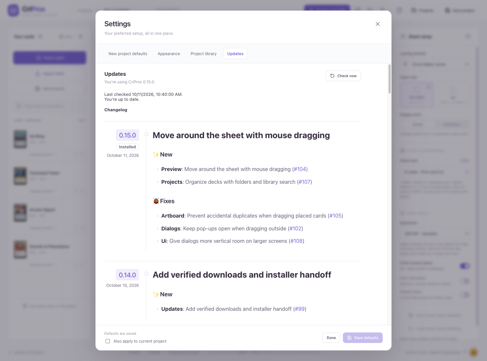

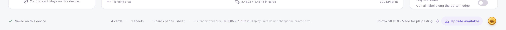

See [Installation](INSTALLATION.md) for the complete guided update flow, manual fallback, and
local simulation commands.

## Experimental layouts

### Six-card candidate area

The default 180 × 220 mm candidate area produces six rotated cards. For the reusable template capture, declare Tabloid inside Design Space, then select US Letter or A4 in the system print dialog and save the one-page PDF at 100% / Actual size. Import that capture into CriProx, print the finished card-sheet PDFs from a dedicated PDF application, and cut with the saved Design Space project. It is not a Cricut-certified profile.

### Seven-card 2–3–2 layout

The Maker/Explore experimental profile uses seven fixed 63 × 88 mm cards, 2.5 mm corners, 0.1 mm spacing, and a 189.2 × 214.2 mm template. Its one-time setup declares Tabloid in Design Space and captures a one-page Letter PDF. Print the finished CriProx PDFs from a dedicated PDF application and cut with that saved project. A one-page PDF capture has passed software geometry checks; sensor acquisition and physical cutting remain unverified.

### Eight-card portrait layout

The Maker/Explore experimental profile uses eight fixed horizontal cards in a 2 × 4 layout with 1 mm gaps. The magenta setup image is 177 × 255 mm. Design Space produces a complete portrait Tabloid capture; CriProx checks every slot and the complete marked footprint, then moves the capture and artwork together onto US Letter or A4 pages at actual size with at least 1 mm clearance. Print the finished PDFs from a dedicated PDF application and cut with the saved Design Space project. Fronts, backs, and previews use the selected output paper. A capture must fit that paper; changing paper requires a matching capture. The Sheet area selector hides layouts unavailable for the selected paper and cutting method; seven-card is Letter-only. Printer margins, sensor acquisition, and physical cutting remain unverified.

### Nine-card manual layout

The manual profile uses nine fixed 63 × 88 mm cards, 2.5 mm corners, 1 mm spacing, and a
191 × 266 mm template. It stays inside the published 11.5 × 11.5 in cutting area of a 12 × 12 in
mat, but it bypasses optical registration and remains physically unverified.

## Current limits

- 500 cards per project.
- 100 copies per entry.
- 20 MB per local image.
- 24 sheets per ZIP; export the current sheet for larger projects.
- One active autosaved workspace. New Project, a project-library selection, or an imported backup
  replaces it.
- No image-upscaling service, printer connection, direct registration scanning/cutting, native Design Space project generation, or cloud sync.
- Registered printing depends on a captured PDF for the exact saved cut job.
- Manual nine-card cutting depends on repeatable page and cut-template placement on the mat.
- Duplex alignment depends on repeatable printer feed.
- Letter output for the six-, seven-, and eight-card profiles uses experimental Tabloid workflows. The eight-card profile requires a full Tabloid PDF capture and produces a new Letter PDF without scaling.

Always inspect the final contour in Design Space, set both dimensions from the supplied manifest, and avoid Auto-Resize. Complete a measured size-check and test cut before using a full sheet of card stock.

AI design edits preserve the current project in Recents before creating or loading another project. If a human opens an editor while an AI operation is rendering, that AI edit is rejected without closing the editor. Catalog card artwork is embedded before it becomes editable; sticker sheet previews use the same cropping, padding, clipping, and border renderer as printed artwork. Changing the sticker machine clears incompatible captured registration marks.
